# 实战一：计算 A 股个股与行业的 CAPM Beta

> 本讲根据**湖南大学金融与统计学院唐国豪教授《量化投资》课程**整理，整理：陈俊希、蒙思宇、王星尧、刘泽楚。  
> 飞书原文：[飞书文档](https://hnufintech.feishu.cn/wiki/JRF9wx8Q5iHUlNk7uaycR8linmg) · 本讲得到 [TRAE 高校扶持计划](https://mp.weixin.qq.com/s/Gg68A1Ue5y-UYR-FXyYeHw) 支持。

::: warning 数据说明
本讲使用 CSMAR 国泰安数据库的数据，需要高校或机构账号才能下载；数据和课程配套代码不随本页公开。
:::

## 理论学习

**$r_{i,t}-r_{f,t}=α_i+β_i(r_{m,t}-r_{f,t})+ε_{i,t}$**

$r_{i,t}$:个股月收益

$r_{f,t}$:无风险收益

**$\alpha_i$**：回归截距，表示控制市场风险暴露后，CAPM 无法解释的平均收益部分。

$r_{m,t}$:市场收益

$β_{i,t}$:股票 $i$ 在时点 $t$ 的市场 Beta，由滚动回归估计

**$\varepsilon_{i,t}$**：残差，表示股票当月超额收益中，模型未能解释的波动部分。

## 数据准备

数据来自CSMAR国泰安数据库

### 公司基本信息
股票市场交易——公司文件——字段设置：全选——csv格式

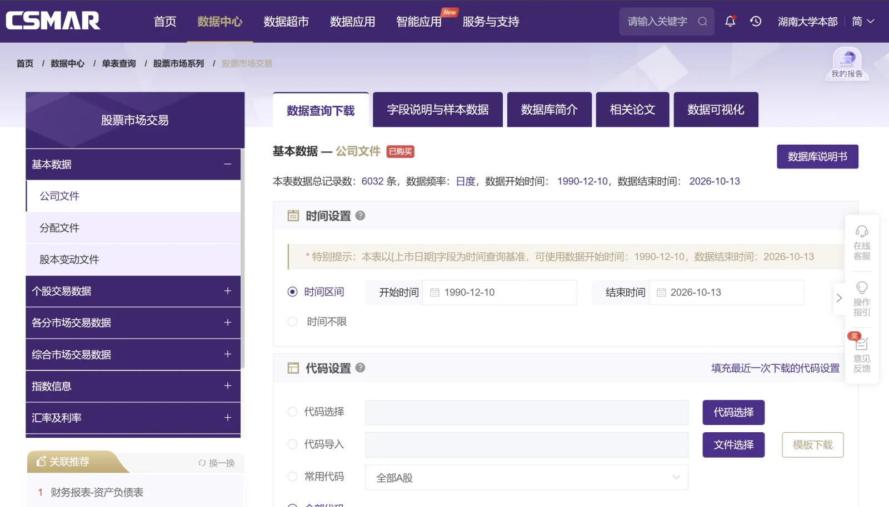

### 无风险利率
汇率及利率——无风险利率文件——全选——csv

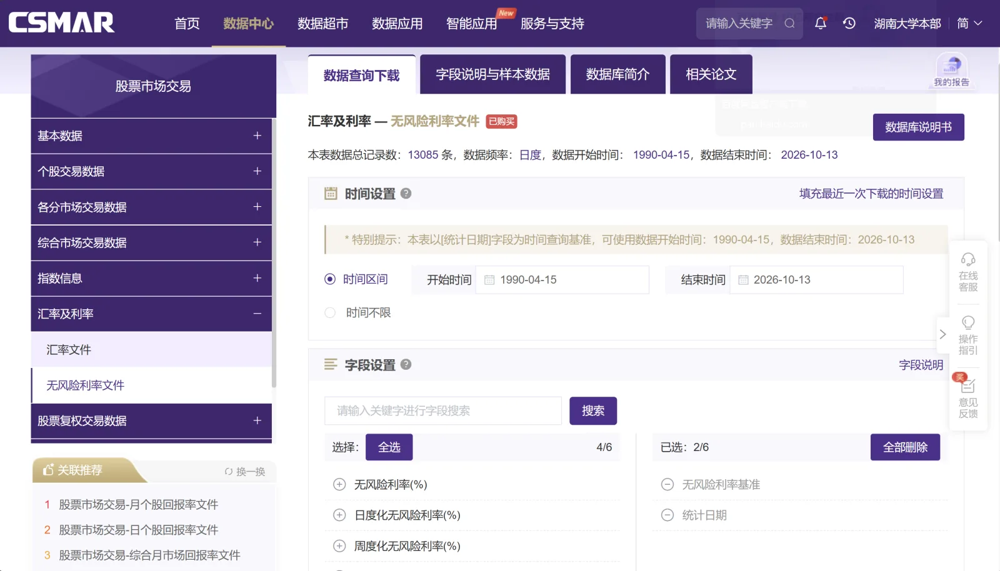

### 月个股回报率
个股交易数据——月个股回报率文件——csv

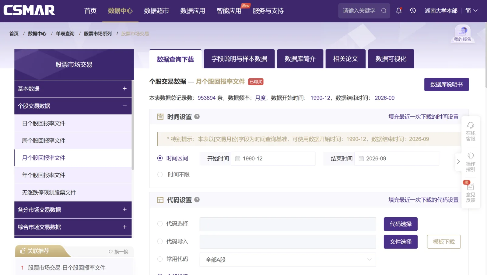

### 综合月市场回报率
综合市场交易数据——综合月市场回报率文件——csv

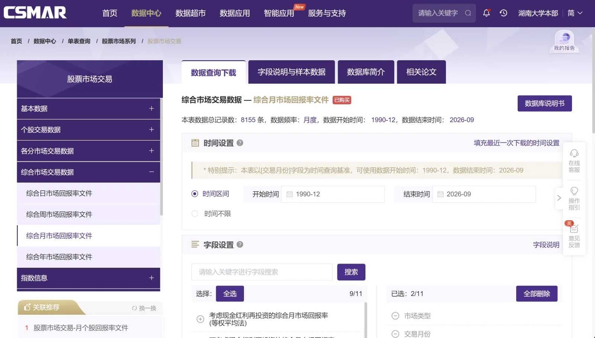

### 参考程序
参考程序（证监会行业指引文件、SAS 版和 Python 版代码）是课程配套资料，未随本页公开。

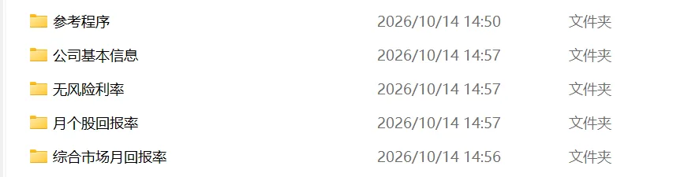

## 程序编写

### Step 1：计算行业beta并作图

#### 利用TraeCode辅助生成代码

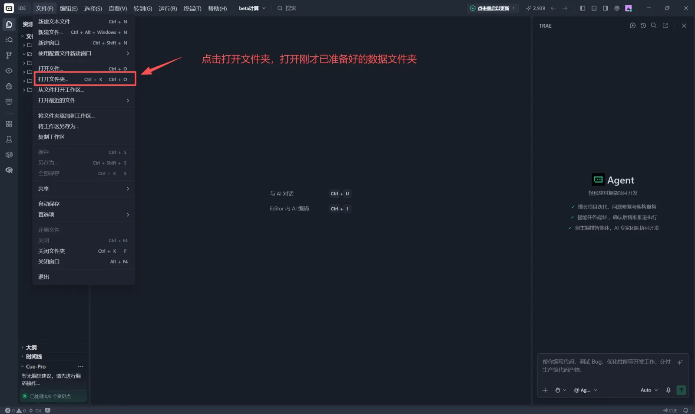

**提示词参考**

::: tip 🧑‍💻 提示词
我现在要计算行业的CAPM beta，  
请你先将“公司基本信息”与“月个股回报率”文件夹中的两个csv文件合并（按照公司代码stkcd一一匹配）。  
其次，按照行业分类代码nnindcd计算月度的股票行业收益率。  
第三，将行业收益率与文件夹“综合月市场回报率”中markettype中21那个类型的数据合并。  
第四，将“无风险利率”文件夹中月度无风险利率（日度数据保留每个月最后一个观测值）与第三步文件合并（注意：无风险利率是取百分号的，因此要除以100，因为其他几步收益率没有取百分号）。  
第五，计算行业beta，并且作图。不懂的可以参考文件夹“参考程序”中的程序。请保留中间程序和所有的数据结果。
:::

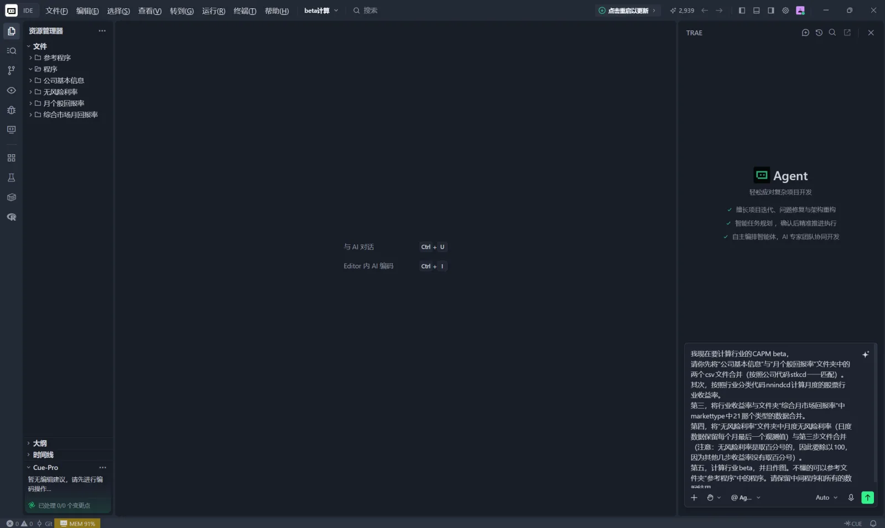

#### 初步结果分析

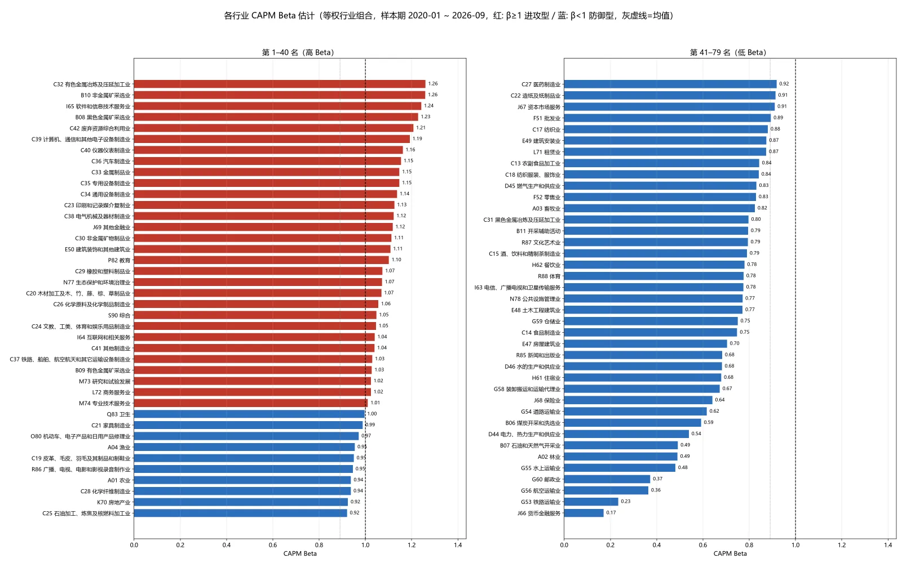

我们比较关注低Beta行业。什么是低Beta，对系统性风险不敏感

根据结果简单分析哪些行业的Beta值比较低，

比如，农业（A01）是典型的低beta行业，绝大多数时间<1，只有在大牛市来临前中期会短暂突破1（2006-2007,2014-2015）。刚需或防御性行业（农业、公共事业等）平时对系统性风险不敏感，beta值低，大于1，说明市场收益波动更敏感，市场情绪狂热，可能为牛市甚至过热的信号。

不是所有金融行业都是高beta，从全样本结果看，某些细分行业（如货币金融服务J66）的beta并没有想象中的高，甚至还比农业低。

#### 图表优化
通常，我们在第一次完成的时候都会优先关注并检查到AI生成的代码是否正确，是否符合我的基础要求这样的基本性内容。所以我们第一次输入的提示词往往没有太多格式美观相关的内容，AI目前在 0 shot 的情况下，想要达到能够最终呈现在报告中的美观，整洁的图表相对困难。所以，在完成基础内容后，我们可以在进行一些形式上的优化。

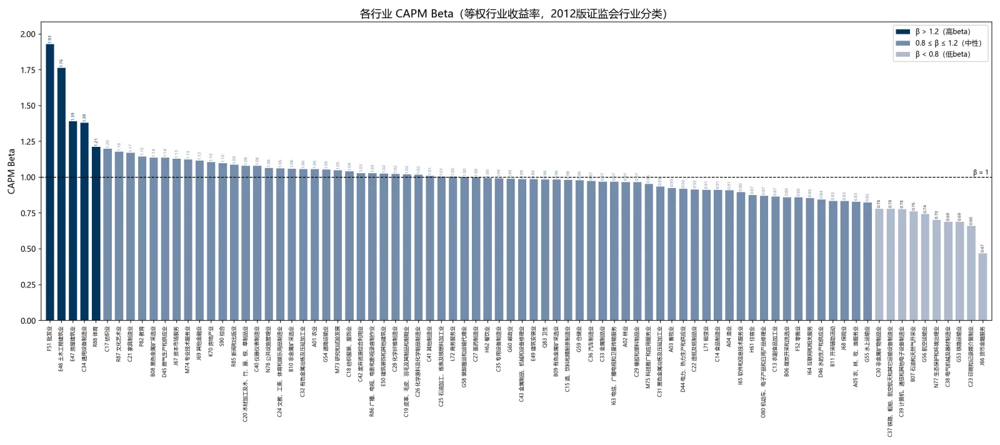

##### 配色参考

以下整理了一些头部券商研报中或期刊论文中常用的绘图配色，供大家参考。可以在提示词中指定颜色和风格进行绘图。

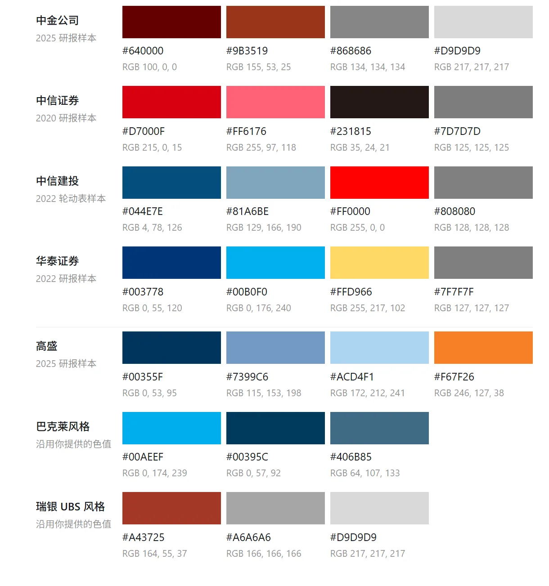

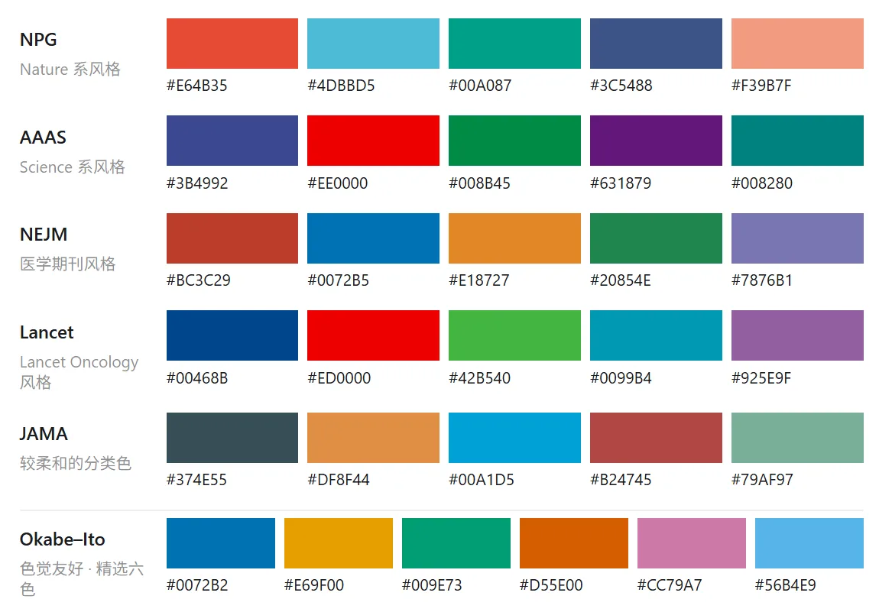

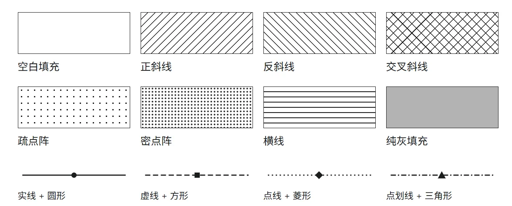

### Step 2：每个行业时变的Beta

#### 利用TraeCode辅助生成代码

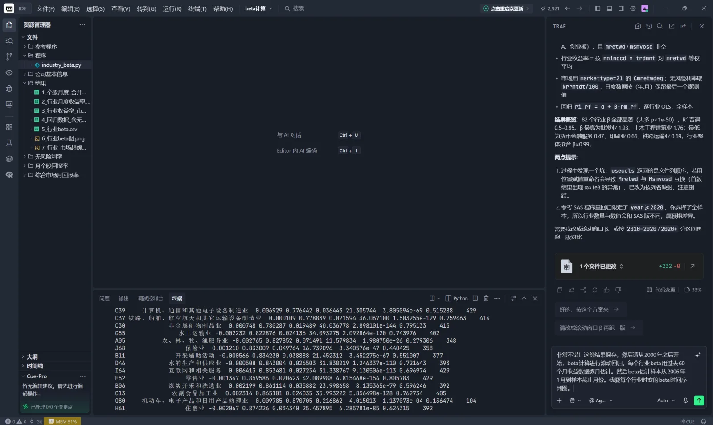

**参考提示词**

::: tip 🧑‍💻 提示词
非常不错！这份结果保存，然后请从2000年之后开始，beta计算进行滚动回归，每个行业beta用过去60个月收益数据逐月估计。然后beta估计样本从2006年1月到样本截止月份。我要每个行业时变的beta时间序列图。
:::

#### 初步结果分析

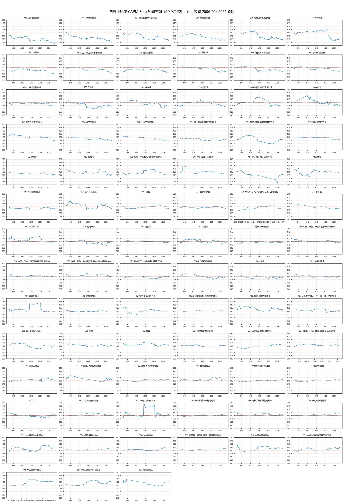

关注beta发生了什么变化，绝大多数beta是时变的，比如农业，甚至如家居制造业耐用消费品也会出现大于1的情况；复印行业从小于1到大于1，原因在于现在电子化程度变高...种种说明beta的时变性与交易有关

汽车制造业2020年前较低，新能源周期后明显上升，文化艺术业2020年前后大于1，现在回落到小于1。

### Step 3：计算个股Beta及与行业beta差值
#### 利用TraeCode辅助生成代码

**参考提示词**

::: tip 🧑‍💻 提示词
非常不错！接下来请你按照这个思路，把个股beta按照60个月滚动回归的方式估计出来，并生成一个csv表格。然后计算个股beta和对应行业beta的差值，把平均差值最大的50家公司时间序列图画出来。
:::

#### 初步结果分析

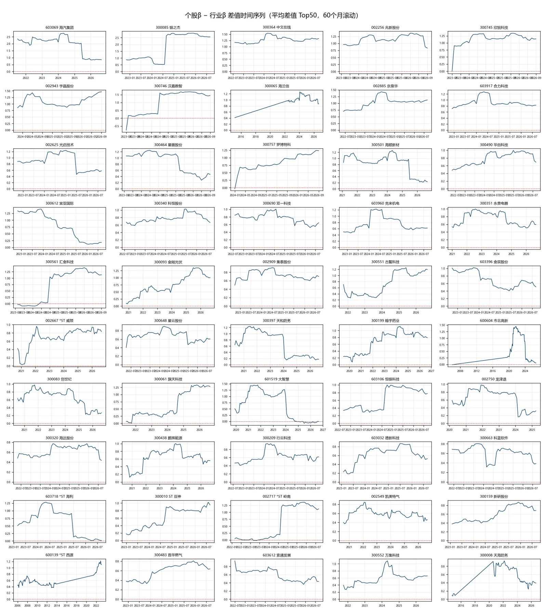

Top3：海汽集团（+1.93，道路运输业）、银之杰（+1.83，软件信息）、中文在线（+1.28，新闻出版），均是个股 β 系统性远高于行业 β 的公司

第三步结果讲解：查看个股beta和行业beta差值大小是否与交易相关；基本逻辑上，个股行业beta和行业beta应该大体一致，而此步作用在于找到相异者，从而挖掘具备投资者主观情绪乃至内部消息的信息；

计算个股与行业的 beta 差值后，我们进一步研究：这一差值是否包含未来收益的信息？相对行业 beta 较低和较高的股票，其后续收益是否存在系统性差异？会不会存在个股beta低于行业beta的，未来收益更高；相反，未来收益较差？

为了提高AI输出质量和代码可审查性，第三步再次分步

### Step 3.1
#### 利用TraeCode辅助生成代码

**提示词参考**

::: tip 🧑‍💻 提示词
非常不错！请分别把这两类50家公司（正偏的前50家公司和负偏的前50家公司）的股票累计收益曲线（和图中的样本期一致）画在beta差值图中，曲线用绿色表示。净值为1的始点请从每个图展示的起始点算。绿线的初始净值请从1开始，最后看累计净值
:::

#### 初步结果分析

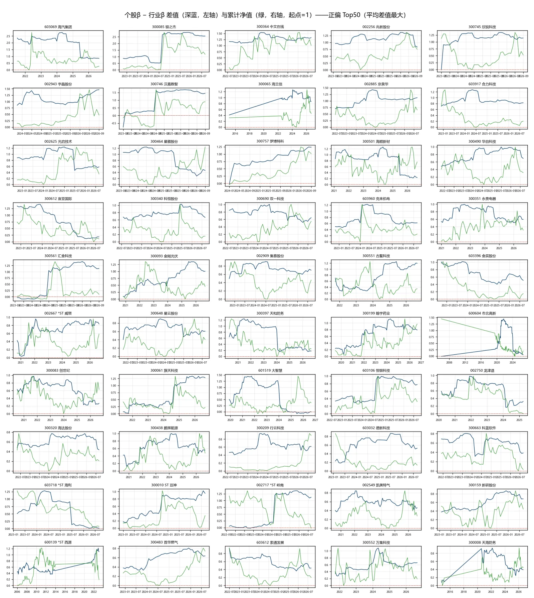

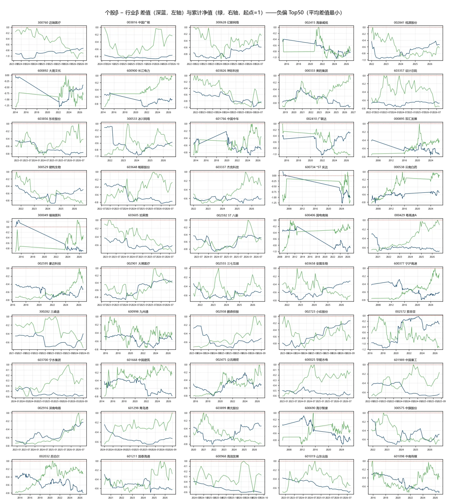

### Step 3.2
#### 利用TraeCode辅助生成代码

**提示词参考**

::: tip 🧑‍💻 提示词
谢谢！帮我在两类图上方，把期末净值大于1的股票名字变红。
:::

#### 初步结果分析

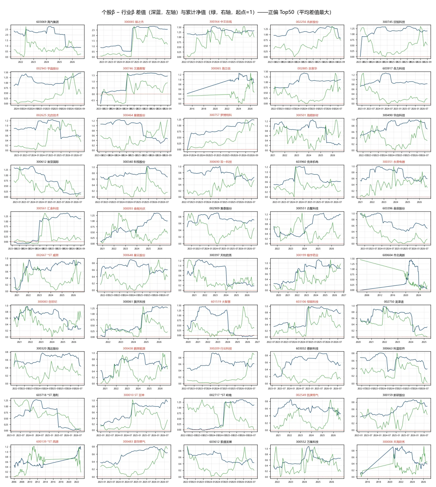

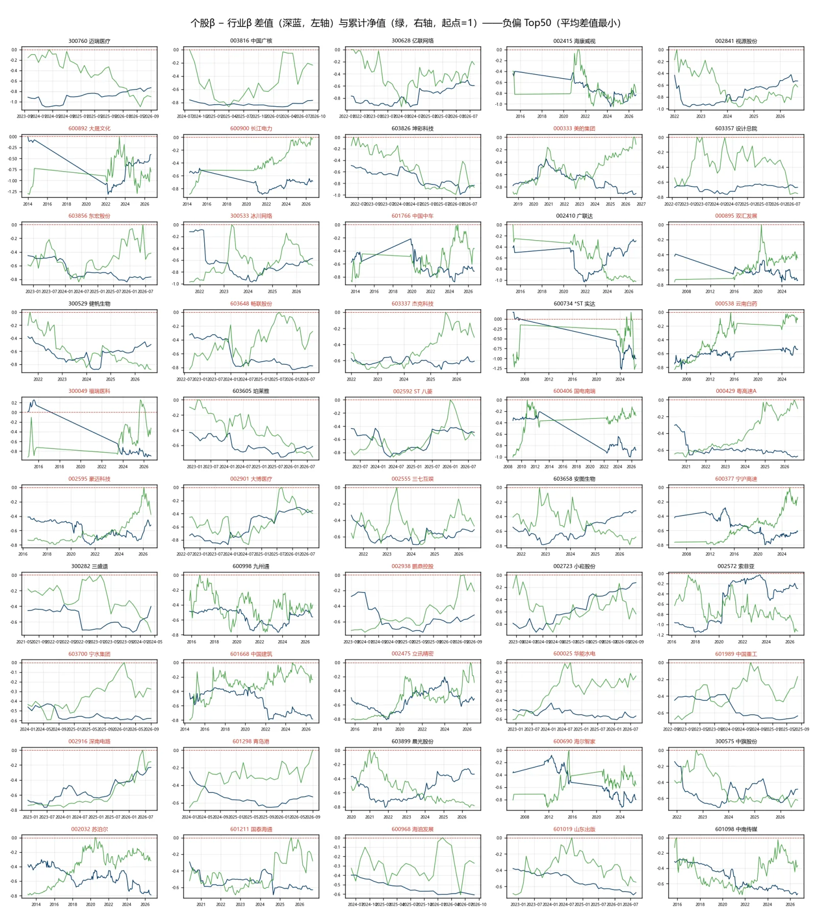

个股beta和行业beta差值分为正向和负向

- 正偏离的股票，beta 可能下降，于是猜想后续收益较弱。
- 负偏离的股票，beta 可能上升，于是猜想后续收益较强。

所以，我们**期待的答案是：负偏离那一组，平均收益可能更好。**

由此衍生量化思维为：每个月构造个股beta和行业beta的差值，买有负偏的公司，做空有正偏的公司

进一步优化：如何行业分类？现在我们行业分类用的是证监会行业分类指引。

如果用年报、新闻、业务描述的相似度重新寻找“同行”，再计算差值，看看更合适的比较对象是否能改善预测。

**延伸阅读**

[papers.ssrn.com](https://papers.ssrn.com/sol3/papers.cfm?abstract_id=4234406)

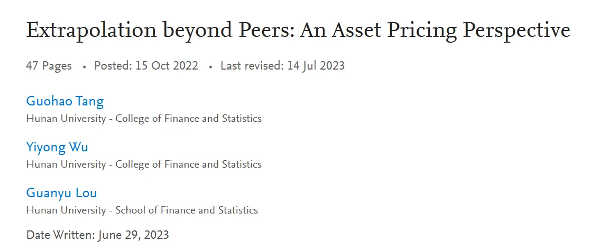

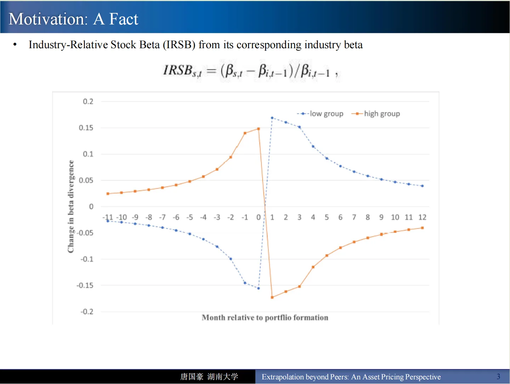

---

本讲用于教育与研究，不构成投资建议。
