# 实战二：中国股票市场的价值效应与规模效应

> 本讲根据**湖南大学金融与统计学院唐国豪教授《量化投资》课程**整理，整理：陈俊希、陈卓然、王星尧、刘泽楚、王子元、陈云、陈怡帆。  
> 飞书原文：[飞书文档](https://hnufintech.feishu.cn/wiki/EU7ZwzeiAiXOU6kYlQcccilZnEc) · 本讲得到 [TRAE 高校扶持计划](https://mp.weixin.qq.com/s/Gg68A1Ue5y-UYR-FXyYeHw) 支持。

::: warning 数据说明
本讲使用 CSMAR 国泰安数据库的数据，需要高校或机构账号才能下载；数据和课程配套代码不随本页公开。
:::

## 任务介绍

利用中国股票市场数据，通过投资组合排序法，检验规模效应和价值效应。

规模效应关注小市值股票与大市值股票的未来收益是否存在差异；价值效应关注高账面市值比股票与低账面市值比股票的未来收益是否存在差异。

产出：回测报告。

## 理论学习

### 计算价值指标

使用账面市值比（Book-to-Market Ratio，简称BM）衡量股票的价值特征：

$$BM_{i,t}=\frac{Book Value_{i,t}}{MarketValue_{i,t}}$$

$BookValue$：**账面权益。** 来自公司财务公告中的资产负债表，通常采用年报数据。年报报告期一般为每年12月31日。这里的账面值指股东权益，不是总资产。

$MarketValue$：**股权市场价值。** 来自股票交易数据，计算思路是股价\*对应股份数量。实际操作中可以直接使用数据库的市值字段，并将月频数据转成年频的。

注意：

定义保持一致**：** 明确账面权益、市值类型、计量单位和取值日期，避免不同步骤使用不同口径。

时效性：尽量用最新的数据。

### 分组

在每个组合形成时点，将符合条件的股票按照核心指标**从小到大分成10组。**

| 检验对象 | 排序指标 | **第1组** | **第10组** |
| --- | --- | --- | --- |
| 规模效应 | 公司市值 | 最小市值股票 | 最大市值股票 |
| 价值效应 | 账面市值比BM | 最低BM股票 | 最高BM股票 |

每组包含大致相同数量的股票。分组应在**同一个时点的股票横截面内**进行，不能把不同年份的数据混在一起排序。

程序中可以用一个分组函数实现这一过程。其作用相当于课程中使用的Group宏：输入分组时间、排序指标和组数，输出每只股票对应的组别。

分组前应处理指标缺失、非正市值等无效记录，并统一相同指标值的处理方式。

### 构建组合，合并未来收益

完成分组后，同一组股票构成一个投资组合，再为每只股票匹配组合形成之后的收益率，要注意合并和计算时的时间对应关系正确。

### 计算组合收益

**（1）市值加权收益**

市值加权给予规模较大的股票更高权重。若按每月初已知的市值配置权重：

$$R_{p,t}^{VW}=\frac{\sum_{i\in p}MV_{i,t-1}R_{i,t}}{\sum_{i\in p}MV_{i,t-1}}$$

其中，$MV_{i,t-1}$ 为股票上一月末的市值，$R_{i,t}$ 为本月收益率，$p$ 表示股票所属组合。

注意使用**上月末市值**，不能用尚未发生的本月末市值给本月收益加权。

**（2）等值加权收益**

等权收益也称等值加权收益，即给予组内每只股票相同的初始资金权重：

$$R_{p,t}^{EW}=\frac{1}{N_{p,t}}\sum_{i\in p}R_{i,t}$$

其中，$N_{p,t}$ 为组合中股票数量。

比较等权与市值加权结果，有助于判断组合表现是否主要受小市值股票影响。

**（3）生成多空对冲组**

在10个组合之外，再构造一个收益差组合，用于比较两端股票的表现。

检验**价值效应**时，采用高BM减低BM：

$$R_{\text{价值},t}=R_{10,t}-R_{1,t}$$

最后，分别展示等权和市值加权口径下的10组收益及多空收益差，比较其平均收益、波动和统计显著性。多空收益差用于检验效应，尚未扣除交易费用，也不等同于能够直接实现的投资净收益。

---

## 数据准备

数据来自CSMAR国泰安数据库。

### 公司基本信息

股票市场系列—股票市场交易—基本数据—公司文件—字段设置：全选—csv格式

 

### 无风险利率

汇率及利率—无风险利率文件—全选—csv

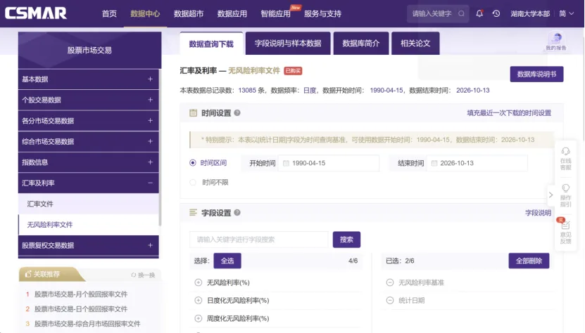

 

### 月个股回报率

个股交易数据—月个股回报率文件—全选—csv

 

### 综合月市场回报率

综合市场交易数据—综合月市场回报率文件—csv

 

### 资产负债表、利润表、现金流量表

公司研究系列—财务报表—资产负债表、利润表、现金流量表—字段设置：全选—csv格式

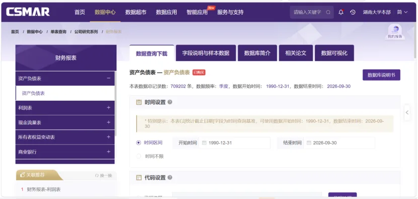

### 数据库说明文件

将数据库文件同步准备在数据文件夹中有助于AI理解其中的数据字段，提高编程准确性。

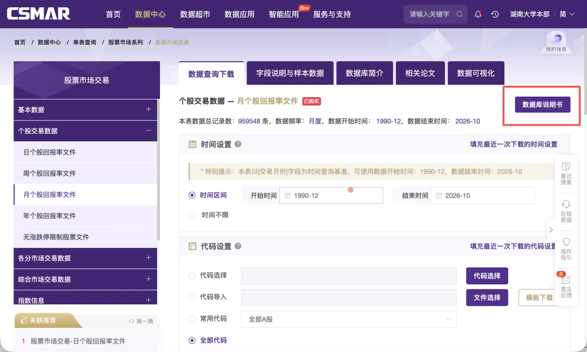

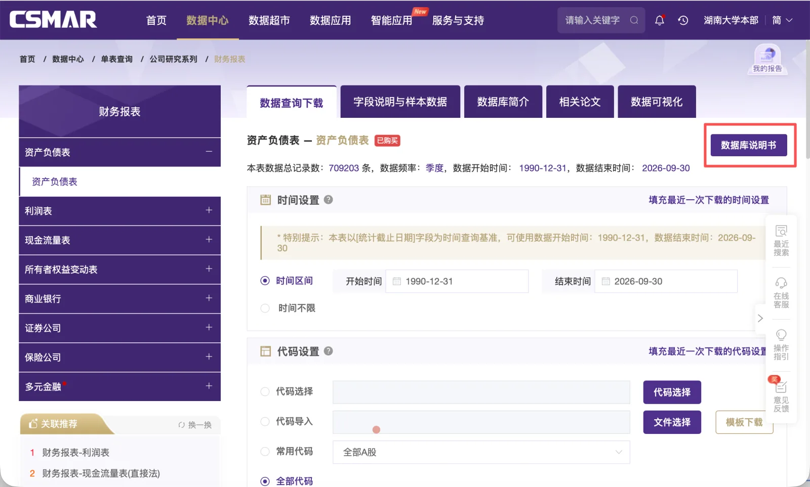

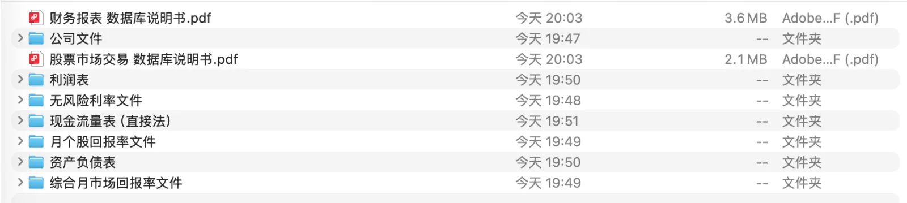

---

## 程序编写

**通用开场提示词**

::: tip 🧑‍💻 参考提示词
我要用中国A股数据，完成“规模效应与价值效应”的投资组合排序检验，请用 Python（pandas/numpy）完成，所有中间结果保存到 output/ 目录。  
每次开始前，请先说明你对这一步的理解和实现计划，等我确认后再写代码；不要跳步，也不要一次性把整条链路写完。  
数据已从 CSMAR 下载并放在 data/ 目录：  
- 月个股回报率：TRD_Mnth.csv  
- 资产负债表：FS_Combas.csv  
- 公司基本信息：STK_Company.csv  
- 数据库说明文件：见 data/ 下的说明文档  
研究口径：  
- 样本期间：2000-01 至 2025-12  
- 市场范围：全A股，剔除B股（200/900开头）  
- 行业范围：剔除金融业，证监会行业代码 J66、J67、J68、J69  
- 保留退市股票在退市前的记录，不要只保留当前仍上市的股票  
图表规范：见“量化研报绘图约束.md”  
请先读取每个文件的字段名、单位说明和样例数据，输出一份“原始字段→含义→本任务使用的字段”的对照表，并说明金额单位（元还是万元）、收益率是否为小数。字段含义不要猜测，以数据库说明为准。
:::

### 价值效应代码——从财务报表到组合收益

#### Step 1：读取并标准化数据

分别读取股票月度交易数据与资产负债表，统一股票代码、交易月份、报告期、字段名称和数值类型

输入：月度交易原始文件、资产负债表原始文件及字段字典

输出：标准化月度交易表和财务报表

AI辅助的部分：辅助编写Python代码，读取两类数据，统一股票代码格式等数据，核对收益率、账面权益与市值单位；输出字段、时间范围、缺失情况等数据基本情况。

::: tip 🧑‍💻 参考提示词
继续。现在做价值效应的 Step 1：读取并标准化数据。  
1）读取月个股回报率和资产负债表，股票代码统一为6位字符串（去空格、前导0补齐）；  
2）交易月份统一为 YYYY-MM，报告期统一为 YYYY-MM-DD；  
3）数值字段转为浮点数，空值、非数值统一为 NaN；  
4）核对三个单位：月回报率是否为小数（0.05 表示 5%）、账面权益单位、市值单位；  
5）输出 stock_month.csv 和 fs_year.csv，并打印字段名、时间范围、行数、缺失情况。  
先说明字段和单位核对结果，再写代码。
:::

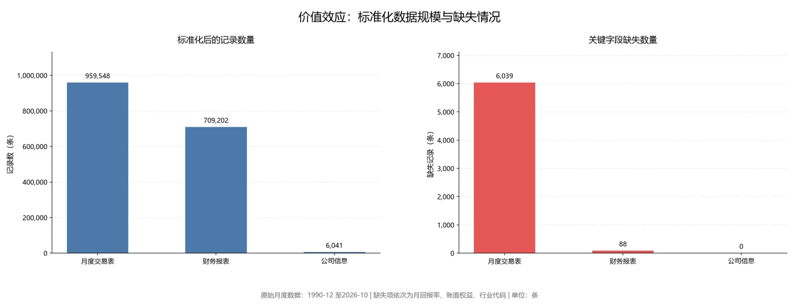

#### Step 2：整理股票月度样本

根据研究期间、市场范围和行业范围筛选交易数据，删除月回报率或流通市值缺失的记录。

输入：标准化月度交易表、样本筛选规则

输出：清洗后的股票月度面板及样本筛选记录表  
AI辅助的部分：根据给定的研究期间和市场类型筛选数据，排除行业代码为J66，J67，J68，J69（证监会行业分类指引中的行业代码，J为金融业）的记录，删除缺失的记录。

::: tip 🧑‍💻 参考提示词
继续。现在做 Step 2：筛选研究样本。  
1）研究期间 2000-01 至 2025-12；  
2）只保留A股，剔除 200/900 开头的B股；  
3）用公司基本信息中的行业代码剔除金融业 J66、J67、J68、J69；同一股票有多条行业记录时，取最新一条，并输出重复记录数；  
4）删除月回报率或流通市值缺失的记录；  
5）保留退市股票在退市前的记录；  
6）输出清洗后的 stock_month_clean.csv，以及一张筛选记录表（每一步剩余行数、删除原因）；  
7）打印样本首尾月份、股票数量、每月平均股票数。
:::

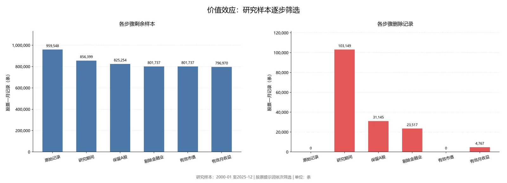

#### Step 3：提取年度账面权益

筛选报告期为12月年末的合并报表，提取所有者权益合计作为账面权益。

输入：标准化资产负债表

输出：股票—报告年度—账面权益表

AI辅助的部分：筛选合并报表及12月31日报告期，提取股票代码、报告年度和所有者权益合计、报告年度和所有者权益合计；检查数据质量

::: tip 🧑‍💻 参考提示词
继续。现在做 Step 3：提取年度账面权益。  
1）只保留 Typrep='A'（合并报表）且 Accper 为 12 月 31 日的记录；  
2）提取股票代码、报告年度、所有者权益合计（A003000000）；  
3）同一股票同一报告年度有多条记录时，保留最新公告/修正后的那条，并说明规则；  
4）检查报告年度范围、每年股票数、所有者权益缺失数量和负值数量；  
5）输出 equity_year.csv（股票—报告年度—账面权益）。  
账面权益为负的记录保留并标记，不要直接删除，后续在报告中说明。
:::

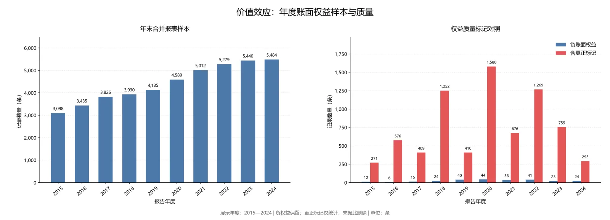

#### Step 4：提取年末市场权益

从股票月度面板中提取每年12月的流通市值，作为计算BM的市场权益。

输入：清洗后的股票月度面板

输出：股票—年度—12月末流通市值表

AI辅助的部分：提取12月记录，保留股票代码、年份和流通市值；检查数据质量

::: tip 🧑‍💻 参考提示词
继续。现在做 Step 4：提取年末市场权益。  
1）从清洗后的月度面板中取每年12月的记录；  
2）保留股票代码、年份、流通市值 Msmvosd；  
3）检查每年12月的股票数、缺失值、市值为0或负值的记录；  
4）核对市值单位，并输出 mv_dec.csv（股票—年度—12月末流通市值）。  
本链路统一用流通市值；不要混用总市值。
:::

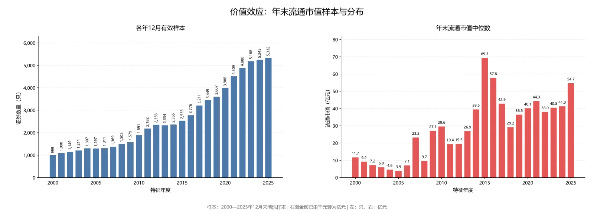

#### Step 5：构造年度BM指标

将同一年年末的账面权益与流通市值匹配，统一单位后计算 $BM=\frac{账面权益}{市场权益}$

输入：年度账面权益表、12月末流通市值表及单位说明

输出：股票—特征年度—BM表

AI辅助的部分：按股票代码和年度合并两张表，根据单位说明将账面权益与流通市值转换到相同单位，再计算BM；输出合并情况、数据情况

::: tip 🧑‍💻 参考提示词
继续。现在做 Step 5：构造年度BM。  
1）按“股票代码 + 年度”合并 equity_year 和 mv_dec（账面权益取报告年度Y，市值取Y年12月）；  
2）根据数据库说明把账面权益和市值转换到同一单位；  
3）计算 BM = 账面权益 / 流通市值；  
4）市值为0或负值的记录剔除，账面权益缺失的记录剔除，分别报告数量；  
5）输出 bm_year.csv（股票—特征年度—BM）；  
6）打印合并前后行数、未匹配记录数、BM的分布（最小值、1%分位、中位数、99%分位、最大值）和异常值数量。
:::

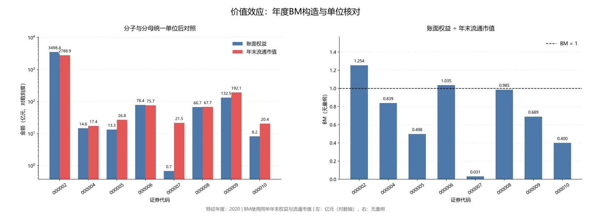

#### Step 6：按年度形成十组组合

在每个特征年度内，根据BM的第10、20、....、90百分位点，将股票从低到高分为10组

输入：年度BM表

输出：股票—特征年度—BM组别表，以及年度分组边界和组内股票数量

AI辅助的部分：按年度计算BM分位点并分组，第1组为最低BM组，第10组为最高BM组；明确边界和并列值处理方式，将缺失BM的记录标记为未分组，输出各组数量及BM分布

::: tip 🧑‍💻 参考提示词
继续。现在做 Step 6：每年按BM分成10组。  
1）在每个特征年度内，按BM从低到高分组，使用10%、20%……90%分位点；  
2）第1组为最低BM组，第10组为最高BM组；  
3）明确并列值的处理方式（同值同组或按排名切分），并说明选择理由；  
4）BM缺失的记录标记为“未分组”，不进入组合；  
5）输出 bm_group.csv（股票—特征年度—BM组别）；  
6）输出每年各组的股票数量、组内BM最小值/中位数/最大值；  
7）检查每年10组是否都非空、组别是否单调、各组数量之和是否等于有效样本；打印某一年的分组明细作为样例。
:::

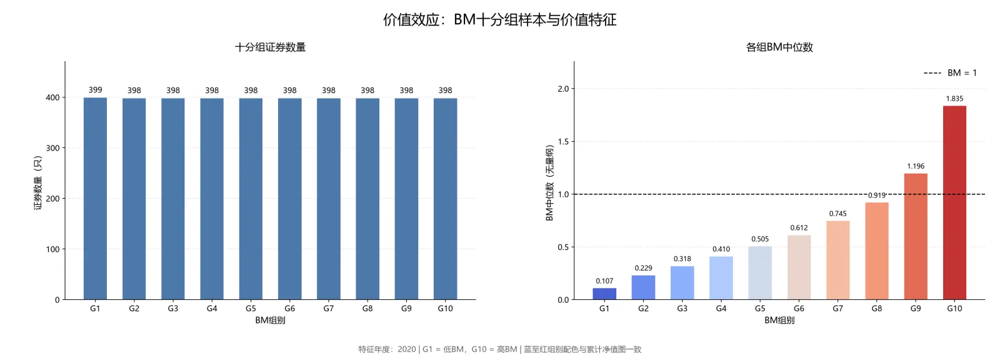

#### Step 7：匹配年度持有期收益

将 $t-1$年年末BM对应的组别，匹配到 $t$年7月至 $t+1$年6月的收益；持有期内组别保持不变

输入：年度BM的组别表、股票月度面板

输出：股票—收益月份—BM组别—月回报率明细表

AI辅助的部分：为每个特征年度建立后续持有期，将年度组别连接到对应月份的股票收益；检查是否有重复匹配和日期错位等情况，输出一只股票跨年度的匹配示例及各月匹配情况

::: tip 🧑‍💻 参考提示词
继续。现在做 Step 7：把年度BM组别匹配到持有期收益。  
1）特征年度Y的组别，持有期为Y+1年7月至Y+2年6月；原因是Y年年报要到Y+1年4月底前才披露，7月建仓可以避免前视；  
2）持有期内组别保持不变，逐月匹配到月个股回报率；  
3）只保留持有期内有收益记录的月份；  
4）检查是否有重复匹配：同一股票同一收益月份只能有一条组别；  
5）输出 holding_panel.csv（股票—收益月份—特征年度—BM组别—月回报率）；  
6）打印一只股票跨年度的匹配示例、各月匹配数量、未匹配记录数。
:::

#### Step 8：构造并处理月度权重

为每个收益月份匹配月末流通市值；先按月份、再按BM组别与月份，分别执行双侧1%的缩尾

输入：持有期收益明细表、股票月度流通市值数据

输出：带原始及处理后权重市值的组合明细表

AI辅助的部分：按股票代码和相邻自然月匹配月流通市值，报告缺失权重；依次完成月度和组内月度缩尾，保留处理前后变量，输出调整情况

::: tip 🧑‍💻 参考提示词
继续。现在做 Step 8：构造并处理月度权重。  
1）为每个收益月份匹配“上一自然月月末”的流通市值作为权重基础（t月收益用t-1月末市值）；  
2）第一层缩尾：在每个收益月份内，对流通市值做双侧1%缩尾，低于1%分位和高于99%分位的值替换为边界；  
3）第二层缩尾：在每个“BM组别 × 收益月份”内，对第一层处理后的市值再做双侧1%缩尾；  
4）保留原始市值、第一层处理后、第二层处理后三列；  
5）输出被调整的记录数，并检查每个组别-月份内权重缺失和权重合计；  
6）输出 port_detail.csv（股票—收益月份—BM组别—月回报率—原始市值—处理后市值）。
:::

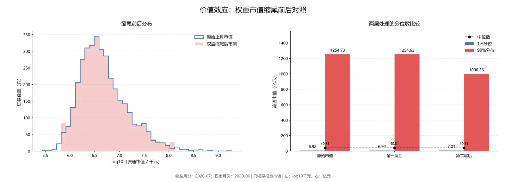

#### Step 9：计算组合月收益

计算十组的等权和市值加权月收益，再计算第10组减第1组的价值多空收益

输入：带权汇总的组合明细表

输出：十组及“高减低”组合的月度等权、市值加权收益序列

AI辅助的部分：按月份和BM组别计算平均回报率，并使用处理后的上月流通市值计算加权回报率；分别构造两种加权方式下的“高减低”收益，输出一个月份的计算明细与权重合计。

::: tip 🧑‍💻 参考提示词
继续。现在做 Step 9：计算十组组合月收益。  
1）等权：按“收益月份 × BM组别”对月回报率取算术平均；  
2）市值加权：在“收益月份 × BM组别”内，用第二层缩尾后的上月市值做权重，组内归一化后加权平均月回报率；  
3）分别构造价值多空：第10组（高BM）减第1组（低BM），等权和市值加权各一条；  
4）检查每月组内权重合计是否为1、各组股票数是否过少；  
5）输出 monthly_returns.csv（月份 × 10组 × 两种加权 + 两条多空）；  
6）打印某一个月的手算明细（组内股票、权重、加权收益）作为样例。
:::

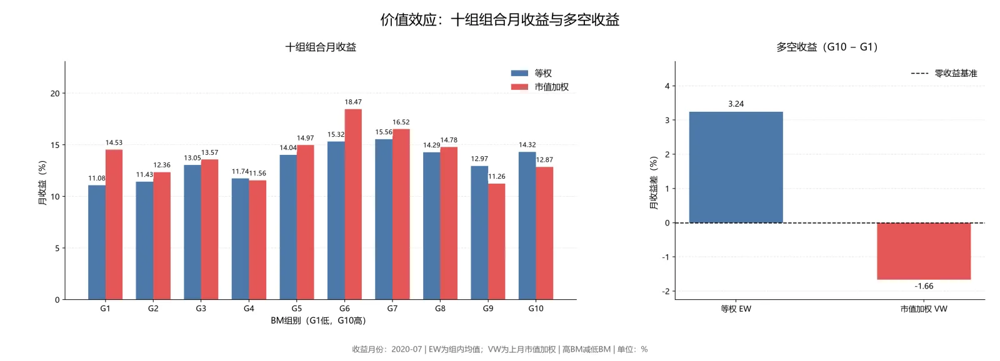

#### Step 10：结果汇总与可视化

计算各组及价值多空组合的平均月收益，整理收益序列和组间比较图

输入：组合月收益序列

输出：平均月收益表、月度收益文件、十组收益比较图

AI辅助的部分：汇总十组和“高减低”组合的平均月收益及有效月份数，绘制等权和市值加权收益比较图，导出结果。

::: tip 🧑‍💻 参考提示词
继续。现在做 Step 10：结果汇总与可视化。  
1）计算十组及价值多空组合的平均月收益、月收益标准差、有效月份数；  
2）如需要，计算年化收益和 Newey-West t值（滞后4期）；  
3）输出 summary_table.csv 和 monthly_returns.csv；  
4）画两张图：(a) 十组平均月收益柱状图，等权与市值加权并排；(b) 十组及多空组合的累计净值折线图，净值从1开始；  
5）图中标注样本期间、调仓频率（年频、7月建仓）、收益单位；  
6）中文标注，配色统一，保存为PNG。
:::

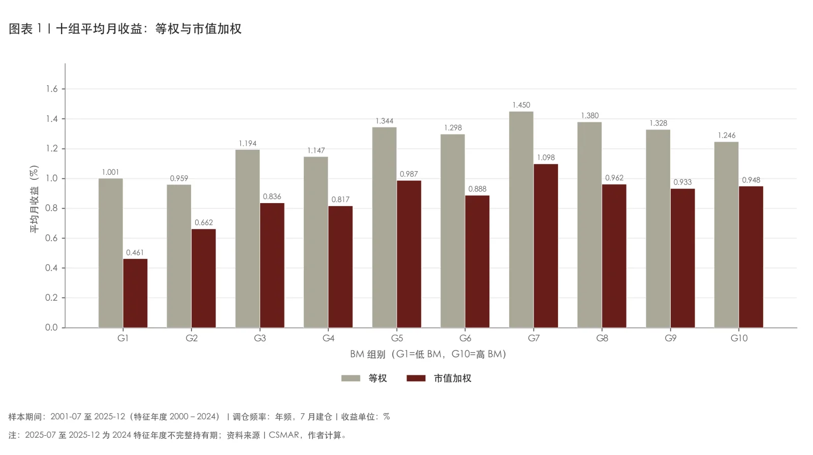

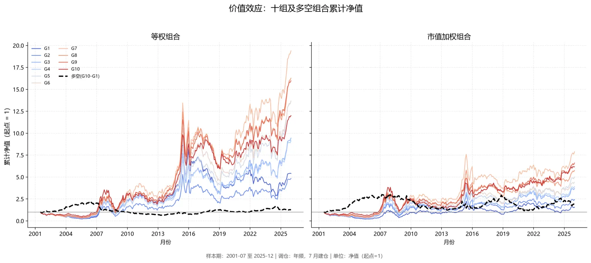

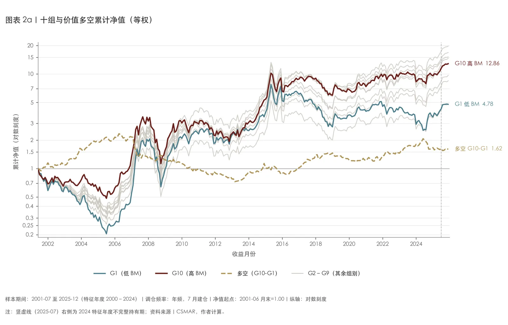

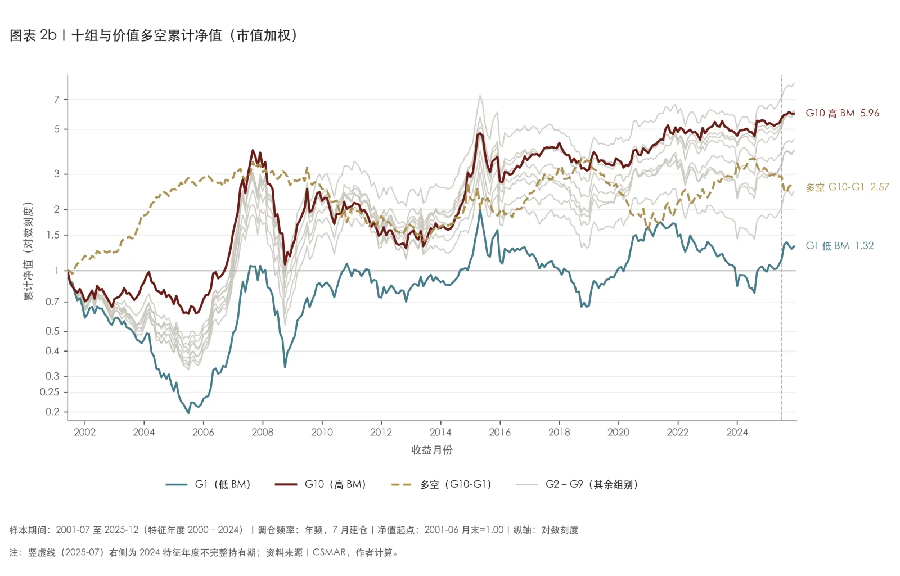

- 十组平均收益并非单调上升 ：等权和市值加权下都是 G7 最高 （1.45% / 1.10%），G10 处于中上位置，不是最高组。
- 价值多空为正但偏弱 ：
- 等权：月均 0.25%，年化 1.99%，月标准差 4.00%，年化波动 13.85%，NW t = 0.96 。
- 市值加权：月均 0.49%，年化 3.93%，月标准差 5.77%，年化波动 19.99%，NW t = 1.55 。
- 两者在双侧 10% 水平下均不显著（|t| < 1.65）。
- 等权各组平均收益普遍高于市值加权 。G1 的等权月均 1.00%，市值加权仅 0.46%，说明低 BM 组中的小盘股贡献较大，压低了等权价值多空。
- 市值加权多空更高但波动也更大 ：VW 多空年化 3.93%，高于 EW 的 1.99%，但年化波动从 13.85% 升至 19.99%。

### 规模效应代码——从股票市值到组合收益

#### Step 1：读取和标准化月度数据

读取股票月度交易数据，统一字段名称、股票代码、月份格式和数值类型核对收益率与市值单位

输入：月度交易原始文件及字段字典

输出：标准化的股票月度数据表，每行代表一只股票在一个月的记录

AI辅助的部分：使用python读取数据，统一字段名称和数值类型；输出相关数据情况

::: tip 🧑‍💻 参考提示词
现在做规模效应的 Step 1：读取并标准化月个股回报率。  
1）股票代码统一为6位字符串，月份统一为 YYYY-MM；  
2）数值字段转为浮点数，空值统一为 NaN；  
3）核对该文件中的月回报率是否为小数、总市值 Msmvttl 的单位；  
4）输出 stock_month.csv，并打印字段名、时间范围、行数、缺失情况。  
先说明单位核对结果，再写代码。
:::

#### Step 2：筛选研究样本

根据研究期间、市场范围和行业范围筛选样本，删除月回报率或流通市值缺失的记录

输入：标准化月度数据、样本筛选规则

输出：清洗后的股票月度面板及样本筛选记录

AI辅助的部分：根据给定的研究期间和市场类型筛选数据，排除行业代码为J66，J67，J68，J69（证监会行业分类指引中的行业代码，J为金融业）的记录，删除缺失的记录。

::: tip 🧑‍💻 参考提示词
继续。现在做 Step 2：筛选研究样本。  
1）研究期间 2000-01 至 2025-12；  
2）只保留A股，剔除 200/900 开头的B股，北交所的股票；  
3）用公司基本信息中的行业代码剔除金融业 J66、J67、J68、J69；同一股票多条行业记录取最新一条；  
4）删除月回报率或总市值 Msmvttl 缺失的记录；  
5）保留退市股票在退市前的记录；  
6）输出 stock_month_clean.csv 和筛选记录表（每一步剩余行数、删除原因）；  
7）打印样本首尾月份、股票数量、每月平均股票数。
:::

#### Step 3：构造规模特征表

使用月末总市值衡量公司规模，整理每个月用于形成组合的股票和规模信息

输入：清洗后的月度面板

输出：股票—形成月份—总市值特征表

AI辅助的部分：提取股票代码、月份和总市值，将总市值定义为规模变量，按股票和月份排序；检查数据质量。

::: tip 🧑‍💻 参考提示词
继续。现在做 Step 3：构造规模特征表。  
1）每个月末提取股票代码、月份、总市值 Msmvttl，作为规模变量；  
2）按股票和月份排序；  
3）检查每月股票数、总市值缺失、为0或负值的记录；  
4）输出 size_feature.csv（股票—形成月份—总市值）；  
5）打印总市值的分布（最小值、1%分位、中位数、99%分位、最大值）。
:::

#### Step 4：按月形成十组组合

每个月内，根据总市值的第10、20、...、90百分位数点，将股票从小到大分为十组

输入：规模特征表

输出：股票—形成月份—规模组别表，以及各月分组边界和组内股票数量

AI辅助的部分：按月份计算总市值分位点并分组：第1组为最小市值组，第10组为最大市值组；明确分位点边界和并列值处理方式，输出各组数量及市值分布

::: tip 🧑‍💻 参考提示词
继续。现在做 Step 4：每月按总市值分成10组。  
1）每个月内，按总市值从低到高分组，使用10%、20%……90%分位点；  
2）第1组为最小市值组，第10组为最大市值组；  
3）明确并列值的处理方式，并说明选择理由；  
4）输出 size_group.csv（股票—形成月份—规模组别）；  
5）输出各月的分组边界、各组股票数量、组内总市值最小值/中位数/最大值；  
6）检查每月10组是否都非空、组别是否单调、各组数量之和是否等于当月有效样本。
:::

#### Step 5：匹配下一月收益与权重

将每个月末形成的组别匹配到下一个自然月收益，并使用形成月份的总市值作为下一月加权收益的权重基础

输入：规模组别表、股票月度面板

输出：包含股票代码、收益月份、组别、月回报率和上月总市值的明细表

AI辅助的部分：按股票代码和相邻自然月连接数据，将形成月份的组别及总市值匹配到下一月收益；输出匹配记录，未匹配记录和跨月匹配示例

::: tip 🧑‍💻 参考提示词
继续。现在做 Step 5：匹配下一月收益与权重。  
1）形成月份M的组别和总市值，匹配到M+1月的月回报率；  
2）权重使用形成月份M的总市值，作为M+1月加权收益的权重基础；  
3）按股票代码和相邻自然月连接，检查跨月匹配、未匹配记录、重复匹配；  
4）输出 holding_panel.csv（股票—收益月份—形成月份—规模组别—月回报率—形成月总市值）；  
5）打印一只股票的跨月匹配示例、各月匹配数量、未匹配记录数。
:::

#### Step 6：处理市值权重

现在每个收益月内，对上月总市值进行双侧1%缩尾；再在每个规模组每个月内，对处理后的市值进行双侧1%缩尾。

输入：带组别、收益和上月总市值的明细表

输出：带最终权重市值的组合明细表

AI辅助的部分：实现两轮顺序缩尾，将低于第1百分位点和高于第99百分位点的数值替换为对应边界；保留原始及处理后的权重市值，输出调整记录数和处理前后分布

::: tip 🧑‍💻 参考提示词
继续。现在做 Step 6：处理市值权重。  
1）第一层缩尾：在每个收益月份内，对形成月总市值做双侧1%缩尾；  
2）第二层缩尾：在每个“规模组别 × 收益月份”内，对第一层处理后的市值再做双侧1%缩尾；  
3）保留原始市值、第一层处理后、第二层处理后三列；  
4）输出被调整的记录数，并检查每个组别-月份内的权重缺失和权重合计；  
5）输出 port_detail.csv（股票—收益月份—规模组别—月回报率—原始市值—处理后市值）。
:::

#### Step 7：计算组合月收益

分别计算十组的等权收益和市值收益加权收益，再计算第1组减第10组的规模多空收益

输入：组别明细表

输出：十组及“小减大”组合的月度等权、市值加权收益序列

AI辅助的部分：按月份和规模组别计算平均回报率；将处理后的上月市值在组内归一化后计算加权回报率；分别构造两种加权方式下的“小减大”收益，并输出一个月份的计算明细与权重合计

::: tip 🧑‍💻 参考提示词
继续。现在做 Step 7：计算组合月收益。  
1）等权：按“收益月份 × 规模组别”对月回报率取算术平均；  
2）市值加权：在“收益月份 × 规模组别”内，用第二层缩尾后的形成月总市值做权重，组内归一化后加权平均月回报率；  
3）构造规模多空：第1组（小市值）减第10组（大市值），等权和市值加权各一条；  
4）检查每月组内权重合计是否为1、各组股票数是否过少；  
5）输出 monthly_returns_size.csv（月份 × 10组 × 两种加权 + 两条多空）；  
6）打印某一个月的手算明细作为样例。
:::

#### Step 8：结果汇总与可视化

计算各组及规模多空组合在研究期间的平均月收益，整理收益序列和组间比较图

输入：组合月收益序列

输出：平均月收益表、月度收益文件、十组收益比较图

AI辅助的部分：汇总十组和“小减大”组合的平均月收益及有效月份数，绘制等权和市值加权比较图，导出结果并标明样本期间、调仓频率和收益单位

::: tip 🧑‍💻 参考提示词
继续。现在做 Step 8：结果汇总与可视化。  
1）计算十组及“小减大”组合的平均月收益、月收益标准差、有效月份数；  
2）如需要，计算年化收益和 Newey-West t值（滞后4期）；  
3）输出 summary_table_size.csv 和 monthly_returns_size.csv；  
4）画两张图：(a) 十组平均月收益柱状图，等权与市值加权并排；(b) 十组及多空组合的累计净值折线图，净值从1开始；  
5）图中标注样本期间、调仓频率（月频）、收益单位；  
6）中文标注，配色统一，保存为PNG。
:::

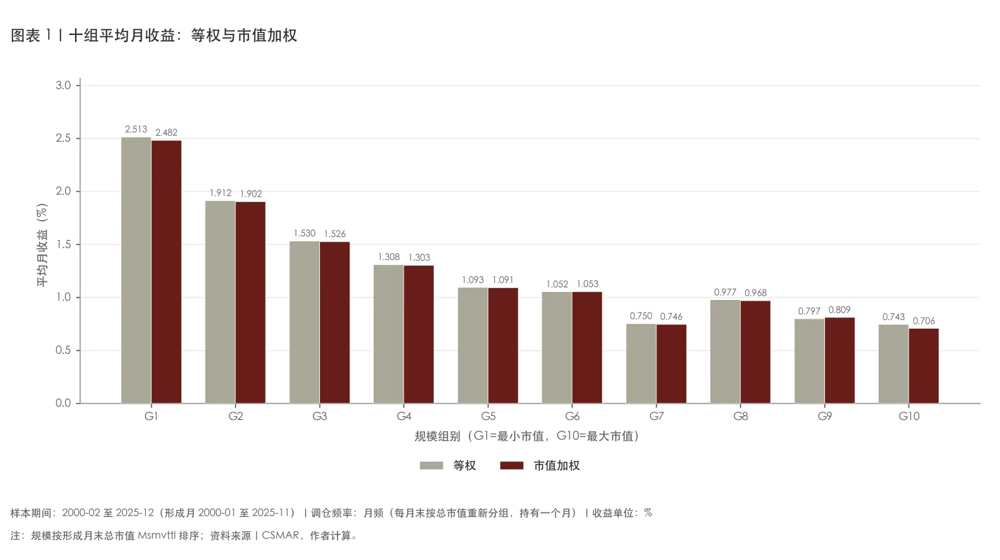

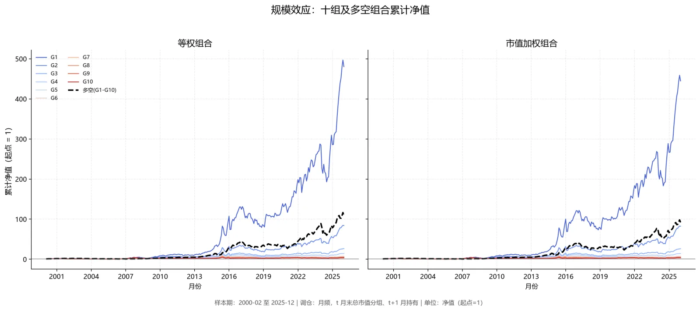

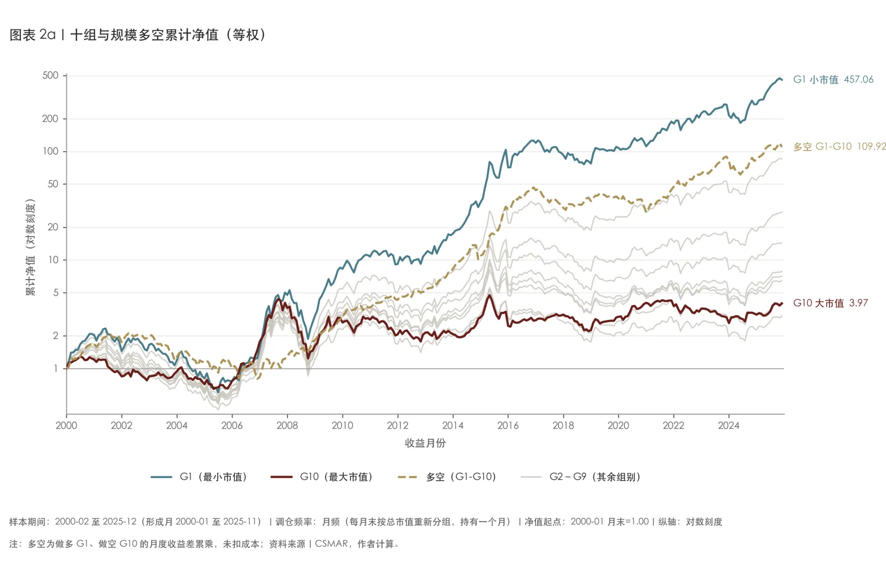

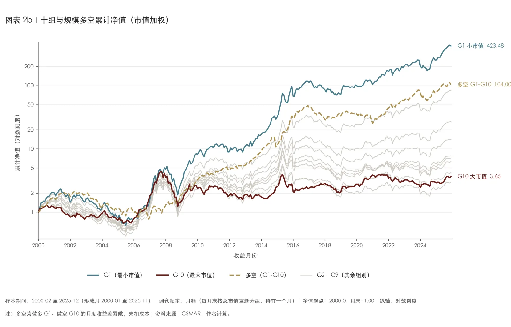

1. 规模效应在 A 股极强且显著 。SMB 月均 1.77%，NW t = 4.16（市值加权 4.01），远超 1% 显著性水平；Sharpe 0.81 也高于任一单组。这与价值效应（t ≈ 1.0–1.6，不显著）形成鲜明对比。
2. 收益随市值单调递减 ，只有 G7 一个凹陷（0.75%），G8 反弹到 0.98%，中盘陷阱现象。
3. 分时段看没有衰减 ：2000–2009 年 SMB 1.19%/月（t=1.65）、2010–2019 年 2.40%（t=4.08）、2020–2025 年 1.69%（t=2.17）。溢价在 2010 年代最强，近六年有所收敛但仍在 5% 水平显著。
4. 风险也集中在小盘 ：G1 年化波动 36.0% vs G10 的 26.7%，2008 年 G1 净值从 5.0 跌到 1.8。

必须说明的 实现偏差 ：等权 G1 累计 457 倍的净值是“理论上可算、实际上难做”的数字。小市值组里大量是 10–20 亿的壳公司（将在后文进行详细解释），真实执行会遇到涨跌停无法成交、流动性不足、退市风险，以及 2017 年后的“炒小炒差”监管约束。

---

## 撰写回测报告

| 类型与参考研报 | 正文的推进逻辑 |
| --- | --- |
| **单因子检验型**：[20160929-华泰证券-多因子系列之二：华泰单因子测试之估值类因子](https://github.com/Barca0412/Introduction-to-Quantitative-Finance/blob/main/%E8%B5%84%E6%96%99/%E5%8D%96%E6%96%B9%E9%87%91%E5%B7%A5%E7%A0%94%E6%8A%A5/%E5%8D%8E%E6%B3%B0%E5%A4%9A%E5%9B%A0%E5%AD%90%E7%B3%BB%E5%88%97/20160929-%E5%8D%8E%E6%B3%B0%E8%AF%81%E5%88%B8-%E5%A4%9A%E5%9B%A0%E5%AD%90%E7%B3%BB%E5%88%97%E4%B9%8B%E4%BA%8C%EF%BC%9A%E5%8D%8E%E6%B3%B0%E5%8D%95%E5%9B%A0%E5%AD%90%E6%B5%8B%E8%AF%95%E4%B9%8B%E4%BC%B0%E5%80%BC%E7%B1%BB%E5%9B%A0%E5%AD%90.pdf) | 定义估值指标 → 分析行业、规模差异与因子相关性 → 分层回测、回归、IC 分析 → 综合比较 |
| **指标改进型**：[2021-03-18_海通证券_选股因子系列研究（七十三）：使用基本面逻辑改进ROE因子](https://github.com/Barca0412/Introduction-to-Quantitative-Finance/blob/main/%E8%B5%84%E6%96%99/%E5%8D%96%E6%96%B9%E9%87%91%E5%B7%A5%E7%A0%94%E6%8A%A5/%E6%B5%B7%E9%80%9A%E6%8A%A5%E5%91%8A/2021-03-18_%E6%B5%B7%E9%80%9A%E8%AF%81%E5%88%B8_%E9%80%89%E8%82%A1%E5%9B%A0%E5%AD%90%E7%B3%BB%E5%88%97%E7%A0%94%E7%A9%B6%EF%BC%88%E4%B8%83%E5%8D%81%E4%B8%89%EF%BC%89%EF%BC%9A%E4%BD%BF%E7%94%A8%E5%9F%BA%E6%9C%AC%E9%9D%A2%E9%80%BB%E8%BE%91%E6%94%B9%E8%BF%9BROE%E5%9B%A0%E5%AD%90.pdf) | 找到传统 ROE 的信息滞后问题 → 检查可能解释 → 加入一致预期 → 引入波动率调整 → 比较各步骤效果 |
| **方法比较型**：[20190104-华泰证券-多因子系列之十：因子合成方法实证分析](https://github.com/Barca0412/Introduction-to-Quantitative-Finance/blob/main/%E8%B5%84%E6%96%99/%E5%8D%96%E6%96%B9%E9%87%91%E5%B7%A5%E7%A0%94%E6%8A%A5/%E5%8D%8E%E6%B3%B0%E5%A4%9A%E5%9B%A0%E5%AD%90%E7%B3%BB%E5%88%97/20190104-%E5%8D%8E%E6%B3%B0%E8%AF%81%E5%88%B8-%E5%A4%9A%E5%9B%A0%E5%AD%90%E7%B3%BB%E5%88%97%E4%B9%8B%E5%8D%81%EF%BC%9A%E5%9B%A0%E5%AD%90%E5%90%88%E6%88%90%E6%96%B9%E6%B3%95%E5%AE%9E%E8%AF%81%E5%88%86%E6%9E%90.pdf) | 介绍合成方法 → 统一测试口径 → 在不同因子类别中比较 → 分析权重稳定性 → 检查参数敏感性 |
| **模型验证型**：[华泰证券-华泰人工智能系列之14：对抗过拟合：从时序交叉验证谈起](https://github.com/Barca0412/Introduction-to-Quantitative-Finance/blob/main/%E8%B5%84%E6%96%99/%E5%8D%96%E6%96%B9%E9%87%91%E5%B7%A5%E7%A0%94%E6%8A%A5/%E5%8D%8E%E6%B3%B0%E4%BA%BA%E5%B7%A5%E6%99%BA%E8%83%BD/%E5%8D%8E%E6%B3%B0%E8%AF%81%E5%88%B8-%E5%8D%8E%E6%B3%B0%E4%BA%BA%E5%B7%A5%E6%99%BA%E8%83%BD%E7%B3%BB%E5%88%97%E4%B9%8B14%EF%BC%9A%E5%AF%B9%E6%8A%97%E8%BF%87%E6%8B%9F%E5%90%88%EF%BC%9A%E4%BB%8E%E6%97%B6%E5%BA%8F%E4%BA%A4%E5%8F%89%E9%AA%8C%E8%AF%81%E8%B0%88%E8%B5%B7.pdf) | 分析原验证方法的假设 → 提出时序验证 → 比较样本内外表现 → 检验因子和组合效果 → 讨论不足 |
| **实盘约束型**：[2023-12-13_海通证券_选股因子系列研究（九十一）：组合规模、交易成本和大单冲击对因子表现的影响分析](https://github.com/Barca0412/Introduction-to-Quantitative-Finance/blob/main/%E8%B5%84%E6%96%99/%E5%8D%96%E6%96%B9%E9%87%91%E5%B7%A5%E7%A0%94%E6%8A%A5/%E6%B5%B7%E9%80%9A%E6%8A%A5%E5%91%8A/2023-12-13_%E6%B5%B7%E9%80%9A%E8%AF%81%E5%88%B8_%E9%80%89%E8%82%A1%E5%9B%A0%E5%AD%90%E7%B3%BB%E5%88%97%E7%A0%94%E7%A9%B6%EF%BC%88%E4%B9%9D%E5%8D%81%E4%B8%80%EF%BC%89%EF%BC%9A%E7%BB%84%E5%90%88%E8%A7%84%E6%A8%A1%E3%80%81%E4%BA%A4%E6%98%93%E6%88%90%E6%9C%AC%E5%92%8C%E5%A4%A7%E5%8D%95%E5%86%B2%E5%87%BB%E5%AF%B9%E5%9B%A0%E5%AD%90%E8%A1%A8%E7%8E%B0%E7%9A%84%E5%BD%B1%E5%93%8D%E5%88%86%E6%9E%90.pdf) | 分析流动性 → 加入组合规模约束 → 加入盘口成本 → 加入大单冲击 → 重新评价因子 |

::: tip 🧑‍💻 参考提示词
请根据 量化研报生成规范.md 文档，将我们刚才的价值和规模效应的分析写成一份word报告，并在其中插入我们刚才做的合适的图表。
:::

---

## 进一步尝试

### BookValue替换

::: info 💡 提示
目前的 $BookValue$使用的是所有者权益，现将其替换成总资产、净营运资本；研发投入，无形资产进行价值效应分析。  
这一探索与BM指标的求解过程相似，所以在与TRAE进行协作的过程中可将规则约束、数据处理代码、反馈格式与产出目标相似的地方留下复用。
:::

> 数据说明：
> 
> 1. 选取时间：交易月份 2001-07 \~ 2026-06；对应投资组合年 2001 \~ 2025（err=2026 的 2026-07 之后月份全部剔除）
> 2. 数据来源：CSMAR国泰安数据库——资产负债表、利润表（仅作为研发投入的数据来源）、月个股回报率
> 3. 样本池：沪深 A 股，**剔除 B 股**；**剔除证监会 2012 版行业大类 J（J66–J69 全部金融业）**，行业映射无法判定的新股（2020-05 后上市，约 1,900 只）保留并披露
> 4. 特殊说明：研发投入信息只在**2018-07\~2026-06披露**，2018年之前一起被涵盖在“管理费用”中进行纰漏。与此同时2018年样本极少，只有12支股票构成，所以该数据质量有很大的缺陷，所得结论不具有反应真实状况的能力，需要后续进行补齐。

####  因子公式与构造规则

1. **AM（总资产市值比）**   
公式：$\displaystyle AM_{i,t}=\frac{TA_{i,t-1}}{MV_{i,t-1}}$  
$TA_{i,t-1}$：股票i，$t-1$会计年末的总资产。
2. **WC_MV（净营运资本市值比）**   
公式：$\displaystyle WC\_MV_{i,t}=\frac{WC_{i,t-1}}{MV_{i,t-1}}$   
$WC_{i,t-1}$：股票i，$t-1$会计年末净营运资本，满足 $WC = \text{流动资产}-\text{流动负债}$。
3. **Intan_MV（无形资产市值比）**   
公式：$\displaystyle Intan\_MV_{i,t}=\frac{Intan_{i,t-1}}{MV_{i,t-1}}$  
$Intan_{i,t-1}$：股票i，$t-1$会计年末无形资产净额。
4. **RD_MV（研发投入市值比）**  
公式：$\displaystyle RD\_MV_{i,t}=\frac{RD_{i,t-1}}{MV_{i,t-1}}$  
$RD_{i,t-1}$：股票i，$t-1$完整会计年度的研发支出（年度流量指标）。

#### 评价体系

1. **分组单调性**：1→10 组年化收益的相邻递增情况与"组均值-组序 Spearman 秩相关"，目的是以较为直观的方式呈现是否存在价值效应。
2. **多空对冲组合**：10组−1组 月收益序列的均值 t 检验、年化收益、夏普、最大回撤（等权 EW 与市值加权 VW 双路径），目的是观察价值溢价是否足够大。
3. **IC 体系**：月度横截面 Normal-IC（Pearson）与 Rank-IC（Spearman），因子值对**下期月收益**；统计 IC 均值、标准差、IC-IR（=均值/标准差）、IC>0 胜率、t 与 p，目的是区分价值因子是否可以带来较为稳定的收益。

#### 单因子解析

因子数据概览表

| 因子 | 窗口(月数) | 多空年化 EW(%) | 多空年化 VW(%) | 夏普 EW | 夏普 VW | 最大回撤 EW(%) | 最大回撤 VW(%) | Rank-IC 均值 | IC-IR | Rank-IC p |
| --- | --- | --- | --- | --- | --- | --- | --- | --- | --- | --- |
| AM | 2001-07~2026-06 (300) | 2.52 | 3.5 | 0.143 | 0.153 | −62.6 | −69.7 | 0.0124 | 0.089 | 0.127 |
| WC_MV | 2001-07~2026-06 (300) | −4.34 | −3.44 | −0.385 | −0.301 | −72.3 | −67.5 | −0.0180 | −0.189 | 0.001 |
| Intan_MV | 2001-07~2026-06 (300) | −0.22 | 0.98 | −0.018 | 0.058 | −50.1 | −51.0 | 0.0074 | 0.08 | 0.169 |
| RD_MV | 2018-07~2026-06 (96) | 9.09 | 7.13 | 0.558 | 0.378 | −34.1 | −33.3 | 0.0368 | 0.183 | 0.061 |

1. **AM（总资产市值比）**

**经济含义**：企业总资产相对市场估值的比率，属"规模/估值"族价值因子；高 AM 表示单位市值对应更多实体资产，偏价值属性。 

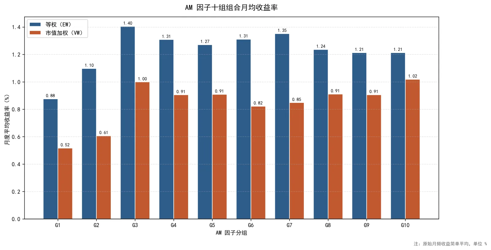

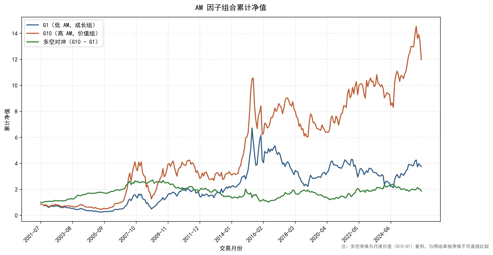

- 分层单调性差，呈“非线性”特征：最高组与最低组均未呈现极致收益，EW组 G3 收益率（1.40%）反而是全场最高。G4-G10组收益均维持在 1.2%-1.3% 之间，这说明 “资产越多越值钱”的逻辑在A股并不通畅。
- 多空极度不显著：EW与VW多空年化收益仅 2.52% 和 3.50%，t值均小于1.5，完全不显著；且多空组合最大回撤分别高达 -62.6% 和 -69.7%，属于灾难级别的回撤。
- IC 体系毫无预测力：Normal-IC 仅为 0.0056（p=0.412），Rank-IC 的胜率与 IR 均极低。
- AM 因子在A股不具备稳定的低估捕捉能力。A股市场对“重资产”企业往往给予折价（担忧资产减值、周转率低下），导致总资产绝对量无法转化为未来的超额收益。

1. **WC_MV（净营运资本市值比）**

**经济含义**：WC = 流动资产 − 流动负债，刻画企业短期资金的宽裕程度。低/负 WC 可能对应两类企业：高效运营（占用上下游资金、现金转换周期短）或流动性紧张；高 WC 则可能对应资金冗余、运营效率偏低或困境累积。该因子方向待检验。

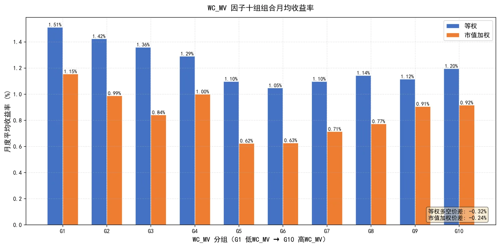

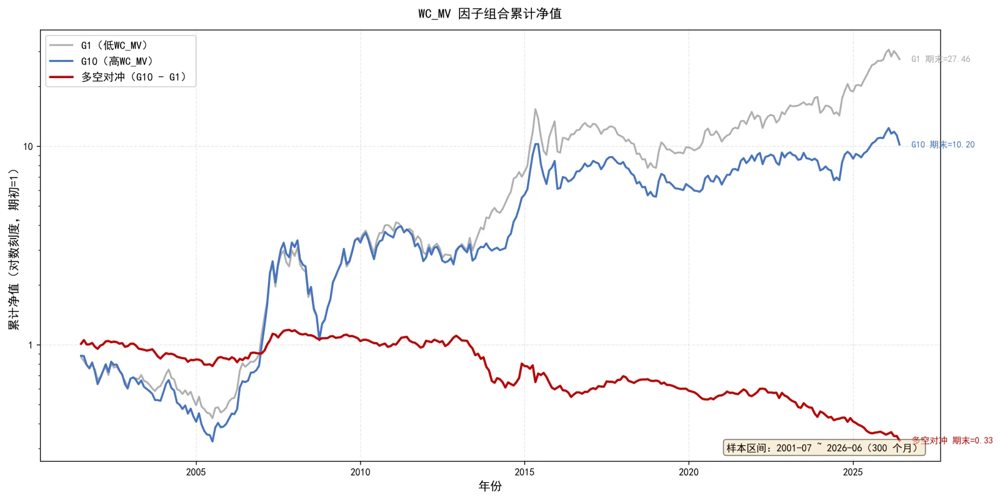

- 出现降序单调性：EW 秩相关达到 -0.60。最低 WC 组（G1）年化收益高达 14.17%，夏普 0.45（四因子中最高）。从累计净值图看，G1（灰线）遥遥领先，且多空对冲的累计净值呈下降趋势。
- 显著的反向多空：反向做多G1、做空G10 可获年化 4.34% 收益（t=-1.68，10%边际显著）。
- IC 显著为负：Rank-IC 达到 -0.0180，p=0.0012，在 1% 水平上显著为负。
- WC_MV 捕捉的是公司的轻资产运营，在产业链的议价权的溢价。低 WC（甚至负 WC）通常意味着企业能强势占用上下游资金（如高周转商超、优质制造业），资金效率极高；而高 WC 可能意味着存货积压或应收账款庞大。在A股，“轻资产”比“重资产”更受资金追捧，市场对高营运资本公司的悲观定价是持续且显著的。这是一个反向辅助因子。

1. **Intan_MV（无形资产市值比）**

**经济含义**：无形资产（土地使用权、专利、软件等）相对市值的比率，试探"无形资产的盈利含量"是否被定价。A 股无形资产构成以土地使用权为主，科技属性弱。

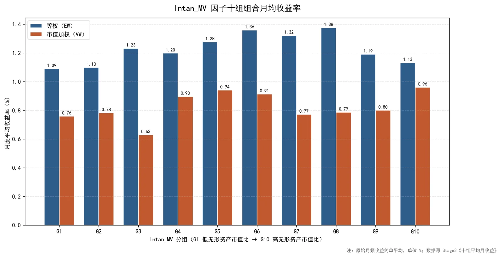

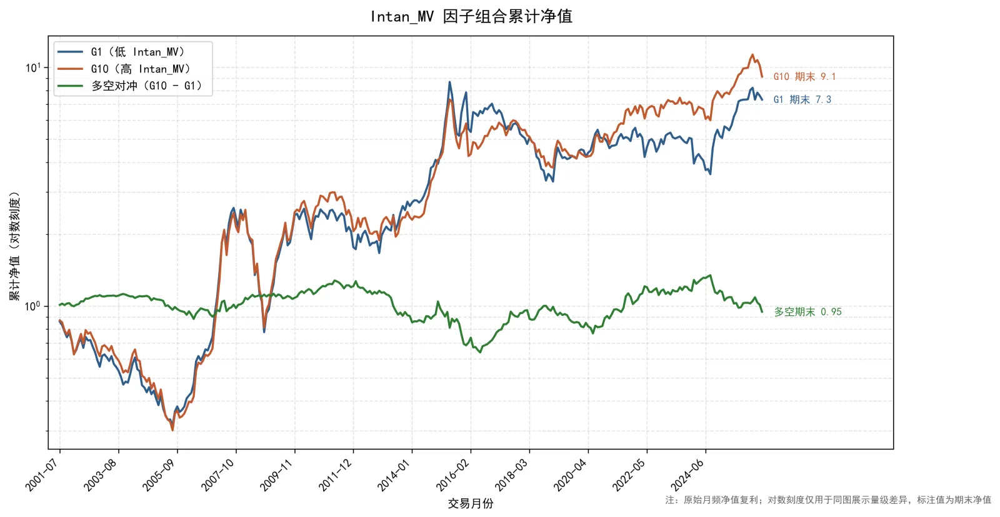

- 完全无规律的单调性：EW 与 VW 的单调性极其混乱，多空期末净值甚至小于 1（EW 0.95），没有明显的方向性。
- 统计指标效果皆差：多空收益 t 值仅为 0.21 和 0.71，统计上完全不显著；Normal-IC 为 -0.0011（p=0.800），Rank-IC 也不显著。
- 该指标在A股表现差强人意。核心原因可能在于A股的资产负债表“表内无形资产”中，土地使用权占比极高，而真正的内生研发、品牌价值往往不在表内（或被费用化）。这导致 Intan_MV 实际上变相成了一个“土地重估”因子，完全无法反映企业的科技含量与成长潜力。如果要研究科技创新，必须弃用这个财务报表指标，转向专利数量或研发人员占比。

1. **RD_MV（研发投入市值比）**

**经济含义**：研发费用（利润表年度流量）相对市值的强度，刻画"每元市值对应的研发投入"。高 RD 企业倾向技术密集型，若研发能转化为未来盈利，应获溢价。注意：仅含**费用化**研发，资本化部分不进入分子。样本仅 96 个月（2018-07\~2026-06）数据缺失较大。

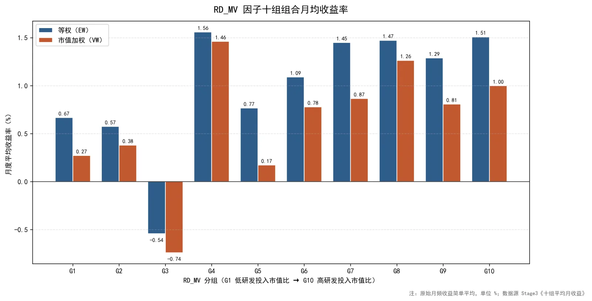

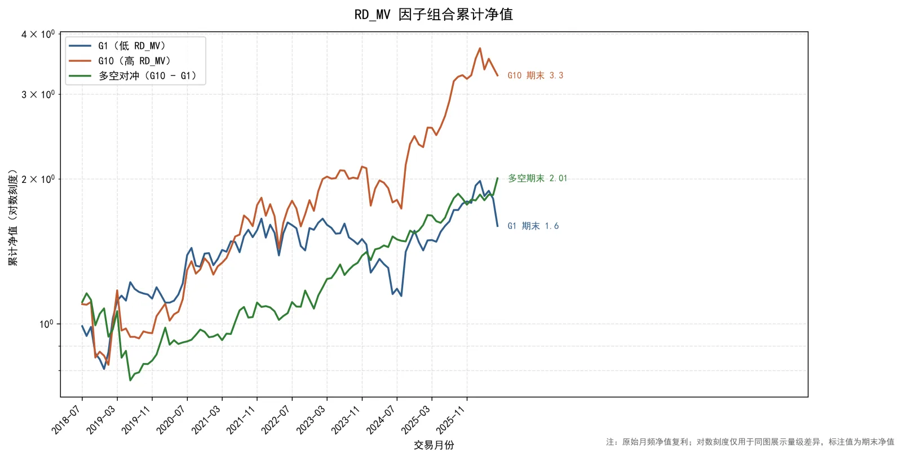

- 非线性跳跃：G1-G3 组收益低迷（G3甚至为负），但 G4-G10 组收益直接跳升至 1.2%\~1.5%。可部分表明高研发才能真正在市场上换来溢价；但到了 G10（极高研发）并没有获得最高收益，反而略有回落，**由于数据局限性该指标异常表现的原因还需进一步探讨。**
- 多空收益可观但极不稳健：EW 年化高达 9.09%，夏普 0.558，为四因子最高。但 t值仅为 1.75（仅10%边际显著），且最大回撤达 -34.06%（发生在2019年）。
- IC 方向性韧性强：虽然均值偏低（Normal-IC 0.0232），但 IC>0 胜率达到 61.7%\~65.4%。说明它大部分时候能判断对方向，但幅度不够稳定。
- RD_MV 在A股是一个“高弹性、高波动”的成长型因子。市场确实愿意为企业的研发投入买单（G4-G10），但由于样本期短、且财务报表只记录“费用化”研发（容易受管理层利润调节干扰），导致其无法成为稳健的底仓因子。建议使用时可剔除尾部极值（如放弃G10组），或者与“高盈利（高ROE）”因子进行交集复合，以剔除劣质公司。

#### 当前局限性

- 财务口径失真与内生噪声：四个因子几乎均受A股报表的限制影响。`RD_MV`因资本化部分缺失且早年样本极薄，存在严重生存偏差；`Intan_MV`受表内资产以土地使用权为主的影响，科技属性完全失真；`WC_MV`的负值既可能是产业链强势占款，也可能是资金链断裂前兆，财务信号具有强多义性。
- 显著的容量约束：所有因子均表现出极端的“EW（等权）强于VW（市值加权）”特征。这意味着因子的超额收益主要依赖中小市值（微盘股）的定价错误，在大市值端被严重稀释。若直接用于大资金实盘，规模扩张将导致Alpha快速衰减。
- 极端的尾部回撤与非对称风险：单因子多空组合历史最大回撤高达-62%至-72%（如AM、WC），主要受极端市场环境（如2008年、2015年）的宏观状态切换冲击。此外，多数因子呈现非线性特征（如RD和AM的中高段才有效），盲目进行多空对冲极易被尾部极端组拖垮。

## 壳价值

::: info 💡 提示
前文用总市值和账面市值比（BM）分析 A 股的规模效应与价值效应。本节加入壳特征得分，看看在市值相近的股票中，财务壳得分高低能否区分下一月收益，以及得分较高的股票是否往往具有较低的 BM。  
这一探索与前文的因子分组回测流程相似。在与 TRAE 协作时，可以复用原有的月度数据匹配、组合收益计算和结果输出代码，新增壳特征得分的计算，并在各市值组内按财务壳得分再次分组。
:::

#### 一、为什么规模与价值因子研究需要考虑壳价值？
前文以股票总市值衡量公司规模，以账面市值比（BM）衡量估值水平，并据此检验中国A股的规模效应与价值效应。然而，上市公司的市场价格除了反映经营资产的价值，还可能包含上市资格带来的额外价值。在中国市场，这一因素对小市值股票尤为重要，也是理解传统因子表现的一条线索。

在较长一段时期内，A股首次公开发行实行审批制或核准制，上市资格相对稀缺，企业从申请到上市往往需要较长时间。一些希望进入资本市场的企业因此选择借壳上市：取得一家已上市公司的控制权，再通过资产重组将自身业务注入上市公司。对于经营状况一般、规模较小的上市公司而言，成为潜在借壳标的的机会本身便可能具有经济价值。这部分价值通常被称为“壳价值”。

Liu、Stambaugh和Yuan（2019，下称LSY）对这一现象进行了系统研究。论文统计发现，2009—2016年发生的借壳交易中，83%的标的公司来自市值最小的30%股票。作者进一步估计，对这一规模区间内的典型股票而言，潜在壳价值约占其市场价值的30%；与此同时，这些股票合计仅占全市场总市值的7%。借壳交易高度集中于小市值公司，而这些公司的价格又可能包含较大的非经营性价值，因此有必要重新审视传统的规模与价值排序。

#### 二、壳价值如何进入股票价格，并影响因子？
壳价值可以理解为一种潜在的交易机会：公司将来被选为借壳标的的可能性越大，交易发生时带来的价值增量越高，投资者愿意为这种机会支付的价格通常也越高。市场对借壳概率及其收益的预期，会随IPO政策、并购环境和市场情绪变化，从而改变壳价值在股价中的比重。

下面用账面市值比（BM）说明壳价值如何影响估值指标。本章以总市值为分母计算 BM，教程前文则使用流通市值。

      若要直接比较两部分结果，需要先统一分母口径。假设某公司的账面权益为10亿元，经营资产价值为12亿元。如果市场只考虑经营资产，其市值为12亿元，BM为10÷12≈0.83。若投资者还赋予它3亿元的潜在壳价值，市值便达到15亿元，BM随之降至10÷15≈0.67。公司的账面权益和经营业务没有变化，但由于市场价格提高，BM从0.83降至0.67。在按BM排序的投资组合中，它因此更可能进入低BM组。

壳价值也可能影响规模溢价和价值溢价的测量。LSY据此在构建中国规模与价值因子时，先剔除市值最小的30%股票，再使用剩余样本排序。论文报告，剔除这部分股票后，月均规模溢价为1.03%（t=3.25），价值溢价为1.14%（t=4.34）；若将其纳入样本，规模溢价升至1.36%，价值溢价降至0.87%。规模溢价的变化与小市值公司的潜在借壳收益有关：当借壳交易发生，或市场提高对借壳可能性的预期时，相关股票可能获得额外涨幅，这部分收益进入小市值组合后，便提高了测得的规模溢价。价值溢价则受到另一种影响：经营盈利较弱的小公司，即使盈利较少，也可能因壳价值而保持较高市值，形成较低的盈利市值比（EP）。这些股票进入低EP组后，其与壳价值有关的收益会提高低EP组合收益，从而缩小高EP减低EP的价值溢价。

LSY使用EP，即每股收益所对应的盈利与市场价值之比，作为价值排序指标；本教程前文使用的是BM，即账面权益与市场价值之比。二者都以市值为分母，因此都会受到额外市场估值的影响，但分别反映盈利与账面净资产两个不同维度。下面将沿用本教程的BM口径，考察壳特征与股票收益、估值之间的关系。

#### 三、如何构造 ShellScore？
要开展实证检验，首先需要将“潜在壳公司”转化为可观察的股票特征。本文从四个方面构造综合壳特征得分ShellScore：公司市值较小、资产负债率较低、上市时间较长，以及历史盈利积累较少。市值反映取得控制权所需的资金规模；杠杆水平反映潜在债务负担；上市时间刻画企业所处的上市生命周期；盈利积累则反映长期经营表现。相应变量及其数据字段见表1。

**表 1  壳特征的四个代理**

| **维度** | **经济含义** | **代理变量** | **数据字段** |
|-|-|-|-|
| 小 | 控制权收购成本较低 | 总市值 MV | Msmvttl |
| 低杠杆 | 潜在债务负担较轻 | 资产负债率 Lev | 负债合计/资产总计 |
| 上市久 | 反映上市生命周期 | 上市月数 Age | 收益库首次出现月 |
| 盈利积累差 | 历史盈利积累较少 | 未分配利润/总资产 | A003105000/A001000000 |

注：市值数据采用CSMAR的Msmvttl字段，财务变量来自资产负债表；计算比率前统一金额单位。

每个月末，先在当月股票样本内对四个特征分别计算百分位排名，再将排名统一到“数值越大、壳特征越明显”的方向。这样既能消除指标单位的差异，也便于将不同维度合成为一个得分。

设rank(x)为变量x在当月股票横截面中的百分位排名，取值在0到1之间。市值、资产负债率及盈利积累使用负向排名，上市年龄使用正向排名。四项排名各占四分之一权重，综合得分定义为：

$$\displaystyle \mathrm{ShellScore}_{i,t}=\frac{1}{4}\left[\mathrm{rank}(-MV_{i,t})+\mathrm{rank}(Age_{i,t})+\mathrm{rank}(-Lev_{i,t})+\mathrm{rank}\left(-\frac{RE_{i,t}}{TA_{i,t}}\right)\right]$$

例如，某只股票当月在小市值、上市年龄、低杠杆和低盈利积累四个方向上的百分位排名分别为0.98、0.60、0.70和0.40，其ShellScore为（0.98＋0.60＋0.70＋0.40）÷4＝0.67。得分越高，说明这只股票在所选特征上越接近研究设定的潜在壳公司画像。这里的ShellScore是教程构建的特征指标，LSY论文中的壳价值则来自实际借壳交易及其概率的估计。

其中，RE/TA指未分配利润与总资产之比，用于描述历史盈利积累；Age为上市月数，本文以收益数据库首次出现月份进行近似，原有数据核对显示99.9%的股票与正式上市日期相差不超过一个月。上述变量的计算统一采用形成月已知的信息。

综合得分已经包含公司规模。为了观察规模之外的财务特征，后续双重排序另外构造一个不含市值的“财务壳得分”。它由低杠杆、低盈利积累和轻资产三个维度组成：前两项沿用综合得分，第三项用存货与固定资产在总资产中的占比衡量。资产占比越低，得分越高。财务壳得分定义为：

$$\displaystyle \text{财务壳得分}_{i,t}=\frac{1}{3}\left[\mathrm{rank}(-Lev_{i,t})+\mathrm{rank}\left(-\frac{RE_{i,t}}{TA_{i,t}}\right)+\mathrm{rank}(-\mathrm{AssetLight}_{i,t})\right]$$

其中的$\displaystyle \mathrm{AssetLight}_{i,t}=\frac{\text{存货净额}_{i,t}+\text{固定资产净额}_{i,t}}{\text{资产总计}_{i,t}}$，对应CSMAR字段A001123000、A001212000和A001000000。综合ShellScore用于刻画整体壳特征；财务壳得分则用于在规模相近的公司之间比较财务特征。以下双重排序和BM分组均采用财务壳得分。

#### 四、壳特征是否预测收益：从单排序到规模控制
实证样本覆盖2000年1月至2026年6月，约78万个股票—月观测。样本保留A股非金融企业，剔除B股、金融行业（J66—J69）以及上市不满6个月的股票。每个月末根据当时已知的特征形成组合，再匹配下一自然月的股票收益。财务变量统一使用已披露年报：7月至次年6月的组合使用上一会计年度年报，以保证排序时能够获得相应财务数据。

收益检验采用五分组排序。对每个特征，将股票从弱到强分成五组，计算最强组减最弱组的月收益差。表中EW表示等权收益，VW表示按上一月末市值加权的收益；t值使用Newey–West方法（滞后4期）计算。通常，t值绝对值超过1.96表示在5%水平上具有统计显著性。

表2显示，四个单项特征中，小市值的收益差最为突出：等权多空组合的平均月收益为1.414%，t值为4.00，市值加权结果同样显著。上市时间长对应的收益差为−0.304%（t=−1.68），方向与预设的壳特征收益方向相反；低杠杆和低盈利积累的收益差分别为0.247%和0.011%，统计上均不明显。将低杠杆、低盈利积累与轻资产合成财务壳得分后，五组等权月收益分布在1.228%至1.280%之间，最强减最弱仅为0.052%（t=0.27）。单项检验中真正突出的变量是公司规模，接下来便需要考察财务壳特征是否具有独立的收益信息。

**表 2  单特征五分组：壳方向（强 − 弱）月均收益**

| **特征** | **等权 %** | **EW t** | **市值加权 %** | **VW t** |
|-|-|-|-|-|
| 小市值（小−大） | 1.414 | 4.00 | 1.341 | 3.39 |
| 上市久（久−新） | −0.304 | −1.68 | −0.350 | −1.80 |
| 低杠杆（低−高） | 0.247 | 1.39 | 0.245 | 1.20 |
| 盈利积累差（差−好） | 0.011 | 0.06 | −0.143 | −0.55 |

注：多空收益均按表中所示方向计算；t值为Newey–West统计量，滞后4期，样本共318个月。

为控制规模的影响，先将股票按总市值分成五组，再在每个规模组内按财务壳得分划分五组，形成表3的5×5投资组合。这样比较的是规模相近股票之间的财务壳特征差异。以最小市值组B1为例，财务壳得分由弱到强的五组月均收益分别为2.150%、2.159%、2.206%、2.252%和2.201%，其中，财务壳得分最强组的月均收益为 2.201%，最弱组为 2.150%，两组相差 0.051 个百分点（t＝0.31）。B4、B5的强弱组收益差分别为−0.340%和−0.344%，也未形成显著的正向溢价。

**表 3  按市值与财务壳得分双重排序的等权月均收益（%）**

| **规模组** | **壳弱** | **2** | **3** | **4** | **壳强** | 组内强减弱（百分点） | **t** |
|-|-|-|-|-|-|-|-|
| B1（小） | 2.150 | 2.159 | 2.206 | 2.252 | 2.201 | +0.051 | 0.31 |
| B2 | 1.518 | 1.468 | 1.362 | 1.305 | 1.482 | −0.035 | −0.18 |
| B3 | 1.069 | 1.033 | 1.068 | 1.109 | 1.019 | −0.050 | −0.28 |
| B4 | 1.020 | 1.018 | 0.791 | 0.881 | 0.680 | −0.340 | −1.72 |
| B5（大） | 0.944 | 0.806 | 0.742 | 0.696 | 0.600 | −0.344 | −1.48 |

注：各列为财务壳得分由弱到强的五分组；格内多空为最强组减最弱组的等权月均收益。

回归分析得到相似的结果。采用Fama–MacBeth方法，逐月以股票下月收益为因变量，并控制总市值的自然对数，综合ShellScore的平均斜率为−0.31%（t=−0.65）。将解释变量改为不含规模的财务壳得分后，平均斜率为−0.42%（t=−1.09）。两种设定均未发现显著的正向收益关系。图1进一步比较了规模多空与财务壳特征多空的累计净值：前者在样本期内显著上升，后者整体接近横向波动。综合来看，小市值股票的收益表现明显强于大市值股票，而这套财务壳特征对未来收益的区分能力较弱。

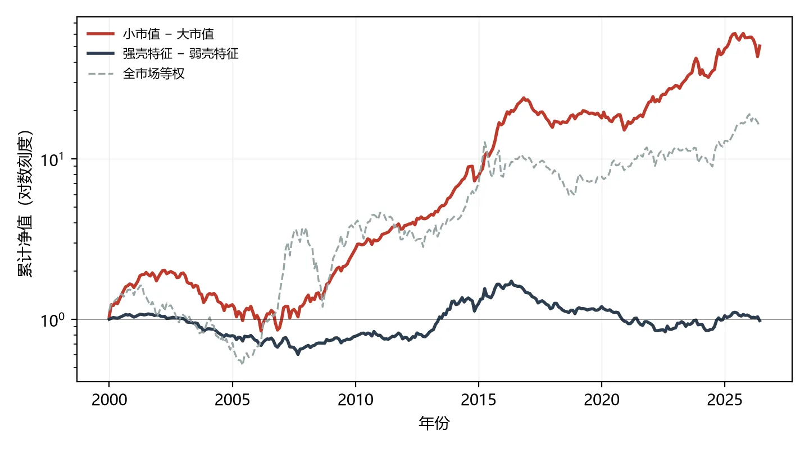

**图1  小市值多空与财务壳特征多空的累计净值（2000—2026年，等权）**

#### 五、壳特征与估值：BM 证据说明了什么？
收益上的差异并不明显，那么财务壳特征是否与市场估值有关？表4按财务壳得分将股票分为五组，比较各组BM中位数及下一月等权平均收益。随着财务壳得分提高，BM中位数由0.432逐步降至0.311；但五组月均收益仅在1.103%至1.196%之间波动，未表现出随得分提高而上升的趋势。也就是说，财务壳特征与较低BM同时出现，却没有对应的显著收益溢价。

**表 4  按财务壳得分分组的 BM 中位数与次月平均收益**

| 财务壳得分组 | **BM 中位数** | **月均收益 %** |
|-|-|-|
| G1(得分最低） | 0.432 | 1.103 |
| G2 | 0.372 | 1.196 |
| G3 | 0.349 | 1.169 |
| G4 | 0.335 | 1.151 |
| G5（得分最高） | 0.311 | 1.170 |

注：使用式（2）的财务壳得分，按全部有效股票分组，BM要求大于0；BM取组内中位数，收益取等权月均。

进一步计算每个月财务壳得分与BM之间的横截面Spearman秩相关系数，318个月的平均值为−0.135，Newey–West t值为−11.59。相关系数绝对值不大，但负向关系在样本期间持续出现，说明财务壳特征较强的股票通常具有更低的BM。

这一现象提供了一个值得追问的线索：较低BM究竟反映了股票市场给予的额外估值，还是来自财务指标之间的共同构成？要回答这个问题，可以直接检查BM与财务壳得分的会计口径。

财务壳得分使用了未分配利润与总资产之比，而BM分子中的股东权益本身包含未分配利润。因此，未分配利润较少的企业，既容易获得较高的财务壳得分，也可能拥有较低的账面权益。两项指标的关联便可能部分来自会计结构。为观察这种影响，本文将未分配利润从BM的分子中扣除，构造调整指标BM_exRE，并重新比较五组中位数。结果依次为0.277、0.273、0.271、0.279和0.300，原先从高到低的BM排列已经消失。这个对照说明，表4所见的估值差异中包含明显的会计科目关联，单凭原始BM排序难以识别潜在壳价值的贡献。

由此，现有实证可以归纳为两点：一是财务壳特征在控制规模后没有表现出显著的未来收益预测能力；二是财务壳得分与BM的负向关系很大程度上受指标构造影响。图2将BM中位数和月均收益并列展示，可以直观看到两者在分组走势上的差异。

本章估值检验使用“年报股东权益÷股票总市值”计算BM；教程前文主流程的BM使用流通市值为分母。比较两部分结果时，应先统一市场价值口径。

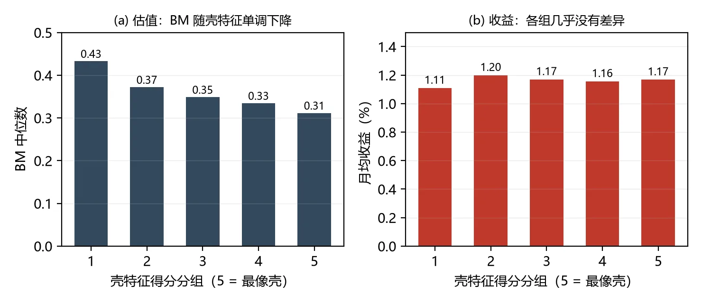

**图2  财务壳特征分组下的BM中位数与平均月收益**

#### 六、对中国 A 股因子构建的启发与下一步实战
如果潜在壳价值主要集中于最小市值股票，那么样本是否包含这部分股票，就可能影响规模因子与价值因子的测量结果。LSY的论文为我们提供了直接的对照：纳入最小30%股票后，规模溢价由1.03%升至1.36%，价值溢价由1.14%降至0.87%。这些变化说明，在中国市场研究规模和价值效应时，样本筛选方式本身就是重要的研究设定。

可以沿用前文已经建立的十分组回测流程，在三套股票样本上重复计算：第一套保留全部股票；第二套剔除当期市值最小的30%；第三套剔除财务壳得分最高的30%。第三套样本采用不含规模的财务得分，重点考察财务特征筛选与市值筛选带来的差异。随后比较三套样本中的规模多空、BM价值多空、等权和市值加权收益，以及Newey–West t值。将排序方法保持一致，便能清楚观察样本筛选对因子表现的影响。

如果剔除最小30%股票后规模溢价明显下降，说明原始规模效应较多集中于微小市值股票；如果价值溢价同时上升，则可以继续分析低BM与高BM组合的成分变化。再比较第二套与第三套样本的结果，可以判断财务壳特征能否提供区别于市值的筛选信息。这一扩展能够直接连接前文的因子构建实验，也为检验LSY的中国市场发现提供新的样本证据。

还可以继续开展两项扩展。

      第一，将价值排序指标从BM改为EP，与LSY采用的价值定义保持一致，考察因子表现是否随估值口径变化。

      第二，引入实际借壳与重大资产重组事件，研究哪些公司特征与借壳发生概率有关，再将事件信息与市场估值和股票收益结合分析。

壳价值的经济基础与上市制度密切相关。从2016年借壳监管调整，到2019年科创板试点注册制，再到2023年全面注册制，中国市场的上市与重组环境经历了显著变化。将样本按制度阶段分组，有助于进一步观察壳特征与传统因子之间的关系是否随制度环境发生变化。

## 延伸阅读与参考资料

《壳溢价：错误定价还是管制风险》<http://www.jryj.org.cn/CN/abstract/abstract447.shtml>

《Size and Value in China》<https://doi.org/10.1016/j.jfineco.2019.03.008>

---

本讲用于教育与研究，不构成投资建议。
